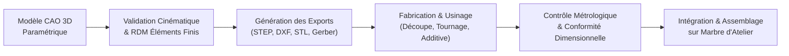

# Du CAO au Réel

## Chaîne Numérique de Fabrication

Le cycle de transition entre la conception assistée par ordinateur et la pièce usinée suit un processus rigoureux de validation géométrique, d'export de fabrication et de contrôle dimensionnel après usinage.

## Formats Numériques et Standards d'Échange

| Type d'opération de fabrication | Format de fichier normalisé | Logiciel source | Destination atelier |
|:---|:---:|:---:|:---|
| Usinage CNC 3/5 axes | `STEP AP214 / AP242` | Fusion 360 / SolidWorks | Centre d'usinage à commande numérique |
| Découpe laser / jet d'eau (tôles plates) | `DXF R12 / 2000` (unités mm) | Export esquisse 1:1 | Machine de découpe laser fibre |
| Cintrage numérique des tubes châssis | `STEP` + fiche de cintrage 2D | Module tube CAO | Cintreuse numérique multi-rayons |
| Impression 3D de prototypes et gabarits | `STL` / `STEP` maillé fin | Trancheur PrusaSlicer/Orca | Impression FDM (PETG/ASA/PA-CF) |
| Fabrication des circuits imprimés | `Gerber RS-274X` + Drill `NC` | KiCad EDA | Fabricant PCB (finition ENIG) |

## Conventions de Nommage et Versioning

Pour assurer une traçabilité rigoureuse, tous les fichiers de CAO et d'usinage respectent la convention suivante :

$$\text{[SYS]\_[SUB]\_[NUM]\_[NOM-PIECE]\_R[INDICE].[EXT]}$$

*Exemple* : `CHAS_SUPP_012_SUPPORT-ETRIER-AR_RB.step`
- `CHAS` : Sous-système Châssis
- `SUPP` : Catégorie Support / Platine
- `012` : Identifiant unique de composant
- `SUPPORT-ETRIER-AR` : Désignation fonctionnelle explicite
- `RB` : Indice de révision (B = version validée après CDR)

## Tolérances Générales et Ajustements Critiques

Le dimensionnement géométrique et le tolérancement (GD&T) appliqués sur les plans 2D s'appuient sur les normes internationales :

1. **Tolérances générales d'usinage** : Norme **ISO 2768-mK** (classe moyenne pour les dimensions linéaires et angulaires).
2. **Tolérances de découpe laser** : Norme **ISO 9013-1** (classe 1 pour les perçages de centrage, classe 2 pour les contours extérieurs).
3. **Ajustements mécaniques des trains roulants** :
   - Portées de roulements d'arbre de roue : **k6** sur l'arbre, **H7** dans les paliers en aluminium.
   - Piges de centrage et goujons de roues : **h7 / H8**.
   - Pivots de fusée de direction : bagues autolubrifiantes bronze fritté ajustées **H7 / f7**.
