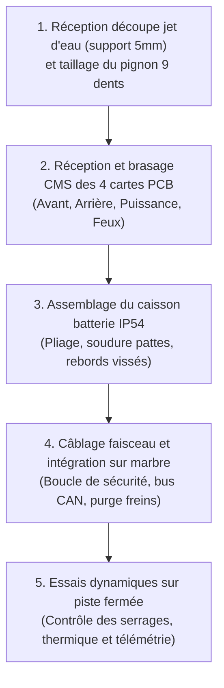

# Essais & Validation

Le plan de validation du kart e-Kart combine des campagnes expérimentales sur maquettes de laboratoire, des essais d'assemblage sur prototypes fonctionnels et des simulations numériques multiphysiques.

---

## 1. Synthèse des Essais de Qualification Réalisés

| Domaine technique | Organe ou sous-système testé | Protocole d'essai | Résultat & Décision technique | Statut |
|:---|:---|:---|:---|:---:|
| **Poste de conduite** | Capteur de consigne d'accélération | Relevé caractéristique tension vs entrefer aimant-capteur à effet Hall | Course utile restreinte (< 5°) et non-linéarité prononcée. **Abandon de l'effet Hall $\to$ Adoption d'un potentiomètre rotatif coaxial $10\text{ k}\Omega$ en prise directe 0–3,3V**. | :material-check-circle:{ .ekart-color-success } Validé |
| **Réseau de bord** | Communication Bus CAN 2.0B | Échange bidirectionnel de trames à $500\text{ kbps}$ entre les deux ESP32 | Validation des broches GPIO 6 et 7. Suppression des conflits avec le bootloader USB série. Bibliothèque applicative en cours. | :material-check-circle:{ .ekart-color-success } Validé |
| **Interface pilote** | Afficheur TFT couleur | Initialisation SPI et rendu des pages graphiques de télémétrie | Initialisation matérielle validée. Ergonomie de l'interface en cours de programmation. | :material-progress-clock:{ .ekart-color-warning } En cours |
| **Structure & Transmission** | Support moteur et brides de réglage | Prototype d'ensemble imprimé en FDM échelle 1:1 monté sur marbre | Validation de l'encombrement, de la cinématique de réglage orthogonal (tension X, alignement axial Y) et du passage des outils M8. | :material-check-circle:{ .ekart-color-success } Validé |
| **Dynamique & Électrique** | Groupe motopropulseur | Modélisation multiphysique sous MATLAB / Simulink / Simscape | Traction sous $42\text{ A}$ continus (pics transitoires à $50\text{ A}$) pour une masse totale de $300\text{ kg}$. | :material-check-circle:{ .ekart-color-success } Validé |
| **Thermique Batterie** | Pack d'accumulateurs 14S4P (Molicel P42A) | Simulation de décharge continue sévère ($> 1\,000\text{ secondes}$) sous Simulink | Échauffement stabilisé entre $37^\circ\text{C}$ et $38^\circ\text{C}$ (partant de $20^\circ\text{C}$). Seuil critique de $80^\circ\text{C}$ non atteint. Emballement thermique écarté. | :material-check-circle:{ .ekart-color-success } Validé |
| **Dissipation PCB** | Hacheurs abaisseurs LM2576HV | Modélisation thermique par vias et plans de masse double face ($R_{\text{th}} = 32\text{ °C/W}$) | Jonction à $65{,}9^\circ\text{C}$ (U1) et $83{,}3^\circ\text{C}$ (U3 pleine charge $3\text{ A}$) sous $T_{\text{amb}} = 40^\circ\text{C}$. Marge conforme sans dissipateur externe. | :material-check-circle:{ .ekart-color-success } Validé |

---

## 2. Campagnes Expérimentales Détaillées

### A. Banc d'Essai du Capteur d'Accélérateur

L'essai visait à qualifier la progressivité du signal de commande envoyé à l'onduleur. 

* **Mesures sur capteur à effet Hall linéaire** : L'acquisition point par point a révélé que la variation utile de tension ($1\text{ V} \to 3{,}5\text{ V}$) se concentrait sur les 5 premiers millimètres de translation de l'aimant. Appliquée à la cinématique de la pédale, cette faible plage correspond à une rotation de moins de $5^\circ$, interdisant tout dosage fin.
* **Qualification du potentiomètre $10\text{ k}\Omega$** : Monté de façon coaxiale sur l'axe fixe de pivotement via un adaptateur rigide, le potentiomètre rotatif exploite l'intégralité de la course angulaire de la pédale ($0^\circ \text{ à } 35^\circ$). Alimenté en $3{,}3\text{ V}$ régulé, le signal délivré est parfaitement linéaire et directement acquis par le convertisseur ADC de l'ESP32 sans étage diviseur résistif.

### B. Validation du Double Réglage de Transmission

L'alignement de la chaîne et sa tension conditionnent le rendement et l'absence d'usure de la denture 219 :

* **Réglage X (Tension)** : Le coulissement des brides sur les tubes du cadre permet d'ajuster la flèche de la chaîne entre $10\text{ mm}$ et $15\text{ mm}$. Le couple de serrage des 6 vis M8 assure un blocage rigide par frottement.
* **Réglage Y (Alignement)** : La platine intermédiaire à trous oblongs permet de corriger le parallélisme pignon-couronne au comparateur ou à la règle laser avec une précision inférieure à $0{,}5\text{ mm}$.

---

## 3. Jalons et Étapes Restantes avant Roulage sur Piste

1. **Usinage définitif** : Découpe jet d'eau de la platine support moteur S235 ($5\text{ mm}$) et usinage CNC du pignon 9 dents selon la norme NF E 26-102.
2. **Fabrication des cartes électroniques** : Réception des circuits imprimés gravés, brasage des composants CMS et tests fonctionnels hors tension.
3. **Mécano-pliage du caisson batterie** : Pliage de la tôle d'acier, montage des rebords pleins vissés, fixation étanche du couvercle et soudage des 4 pattes de fixation au châssis.
4. **Intégration et contrôles de sécurité** : Câblage du faisceau unifilaire, validation de la boucle d'arrêt d'urgence en sécurité positive et contrôle d'isolement haute tension.
5. **Essais de roulage progressifs** : Premiers tours de piste à puissance bridée ($20\%$), suivis d'une montée en charge avec surveillance télémétrique des températures de cellules et d'onduleur.
