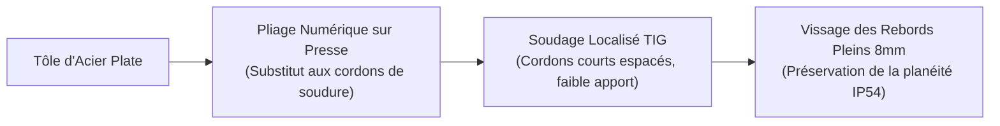

# Processus de Fabrication

La concrétisation physique du kart e-Kart mobilise des procédés d'atelier complémentaires, choisis pour garantir la précision géométrique, l'absence de déformations thermiques indésirables et la conformité aux normes industrielles.

---

## 1. Découpe Jet d'Eau Abrasif (Support Moteur)

La platine support moteur ($5\text{ mm}$ en tôle d'acier S235) est réalisée par **découpe au jet d'eau abrasif** à haute pression :

* **Validation d'atelier** : Faisabilité confirmée avec le responsable d'atelier (M. Schalck) sur brut disponible de $5\text{ mm}$.
* **Suppression de la Zone Affectée Thermiquement (ZAT)** : Contrairement à la découpe laser ou plasma, le procédé par jet d'eau est athermique. Il élimine tout risque de trempe locale, de contraintes résiduelles de retrait ou de gauchissement de la plaque.
* **Précision dimensionnelle** : Tolérances obtenues de l'ordre de $\pm 0{,}1\text{ mm}$ sur les entraxes des 6 perçages et sur l'alésage central de passage du moteur électrique.
* **Finition** : Ébavurage manuel et chanfreinage des arêtes après découpe.

---

## 2. Mécano-Pliage Maîtrisé (Boîtier Batterie IP54)

La fabrication du caisson de batterie fait appel au mécano-pliage de tôle d'acier avec une gestion stricte des apports calorifiques :

* **Priorité au pliage** : Les arêtes du caisson sont obtenues par pliage sur presse afin de diviser par trois la longueur totale des cordons de soudure. Cela supprime le risque de vrillage de la tôle fine au refroidissement.
* **Rebords d'étanchéité vissés** : Des barres pleines en acier de section carrée $8 \times 8\text{ mm}$ sont fixées par vissage mécanique fraisé sur le pourtour. L'inertie thermique des barres pleines étant très supérieure à celle de la tôle, leur soudage aurait induit des retraits asymétriques détruisant la planéité du plan de joint.
* **Taraudage dans la masse** : Taraudage des trous borgnes M4 directement dans l'épaisseur des barres de $8\text{ mm}$ pour le vissage du couvercle démontable.

---

## 3. Usinage de Précision (Pignon Moteur & Trains Roulants)

* **Pignon moteur 9 dents compétition (Chaîne 219)** :
    - Tournage de l'ébauche cylindrique au diamètre extérieur de $28 \pm 0{,}1\text{ mm}$ avec usinage des deux chanfreins d'attaque de $15^\circ$ sur $1\text{ mm}$.
    - Taillage de la denture sur centre d'usinage CNC selon les équations strictes de la norme **NF E 26-102 (ISO 606)**.
    - Usinage du fond de denture calibré à un diamètre de $4{,}70\text{ mm}$ ($r = 2{,}35\text{ mm}$), rigoureusement centré dans la tolérance normative $[2{,}318 ; 2{,}433]\text{ mm}$ pour empêcher tout arc-boutement des rouleaux de chaîne.
* **Liaisons mécaniques de l'arbre arrière** :
    - Paliers en aluminium usinés avec alésages en tolérance **H7**.
    - Arbre rigide rectifié $\varnothing 30\text{ mm}$ en tolérance **k6** sous les roulements.

---

## 4. Prototypage Rapide et Fabrication Additive FDM

La fabrication additive est exploitée pour valider les interfaces avant usinage définitif :

* **Spacers de cellules modulaires (PETG)** :
    - Impression des entretoises modulaires V2 en PETG haute ténacité.
    - Résistance thermique supérieure au PLA ($T_g \approx 80^\circ\text{C}$), garantissant la stabilité géométrique face à l'échauffement interne du pack.
* **Prototype fonctionnel du support moteur et des brides (FDM)** :
    - Impression à l'échelle 1:1 de l'ensemble platine, brides et platine intermédiaire à trous oblongs.
    - Validation physique sur marbre : validation de l'encombrement avec le châssis, cinématique du double réglage orthogonal (tension X et alignement axial Y), et confirmation du dégagement des clés de serrage M8.

---

## 5. Fabrication des Circuits Imprimés (PCB)

L'électronique embarquée repose sur 4 circuits imprimés double face conçus sous Proteus et transmis en fabrication industrielle :

* **Finition des pistes** : Cuivre $35\text{ µm}$ (ou $70\text{ µm}$ pour la carte de distribution de puissance), finition de surface ENIG (or chimique sur nickel) pour une excellente planéité et soudabilité des composants CMS.
* **Dissipation thermique intégrée** : Matrice dense de vias thermiques métallisés reliant les zones de cuivre double face sous les hacheurs LM2576HV, garantissant $R_{\text{th}, j-a} = 32\text{ °C/W}$ sans dissipateur aluminium additionnel.
* **Assemblage** : Soudage à l'air chaud et fer thermorégulé des boîtiers CMS (MOSFETs DPAK, régulateurs, transceivers CAN) et inspection optique des soudures.
