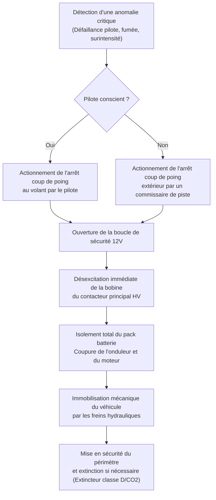

# Sécurité & Homologation

## Analyse Préliminaire des Risques (APR)

La conception et l'expérimentation d'un kart électrique engagent des risques industriels et opérationnels majeurs classifiés ci-dessous :

- **Risque Électrique Haute Tension** : Présence d'un bus continu $48 - 72 \text{ V DC}$ avec des courants de court-circuit potentiels supérieurs à $1\,000 \text{ A}$. Risque d'arc électrique et d'électrisation.
- **Risque Électrochimique & Thermique** : Emballement thermique potentiel sur cellule lithium en cas de surcharge, perforation ou surchauffe. Risque d'émission de gaz fluorés et d'incendie auto-entretenu.
- **Risque Mécanique** : Éléments tournants à haute vitesse cinétique (chaîne, couronne arrière, arbre de transmission, roues) et risques de collision sur piste.

## Matrice des Équipements de Protection Individuelle (EPI)

| Équipement de protection | Contexte d'utilisation | Niveau d'exigence | Référence normative |
|:---|:---|:---:|:---|
| Casque intégral homologué | Roulage et essais dynamiques | Obligatoire | ECE 22.06 / Snell SA2020 |
| Gants isolants d'électricien ($500 \text{ V}$) | Interventions et câblage sous tension | Obligatoire | NF EN 60903 (Classe 00) |
| Écran facial / lunettes de sécurité | Soudage, usinage et mise en service électrique | Obligatoire | EN 166 (Protection contre les arcs) |
| Combinaison ignifugée | Roulage sur piste fermée | Recommandé | Homologation FIA / CIK-FIA Niveau 2 |
| Chaussures de sécurité avec semelle isolante | Atelier de fabrication et paddock | Obligatoire | ISO 20345 (S1P / S3) |

## Dispositifs de Sécurité Embarqués

- [ ] **Arrêt coup de poing pilote** : Bouton d'arrêt d'urgence type champignon rouge monté sur le volant ou la colonne, accessible instantanément par le pilote.
- [ ] **Arrêt d'urgence commissaire extérieur** : Bouton d'arrêt d'urgence externe positionné sur la partie supérieure de l'arceau/siège, facilement manoeuvrable par un tiers.
- [ ] **Contacteur électromécanique principal** : Coupure bipolaire à rupture brusque commandée par la boucle de sécurité basse tension.
- [ ] **Fusible haute tension calibré** : Protection contre les surintensités franches (type gBat ou cartouche semi-conducteur ultra-rapide).
- [ ] **Contrôleur permanent d'isolement (CPI / IMD)** : Détection temps réel de toute fuite de courant entre le pôle positif/négatif haute tension et le châssis mécanique.
- [ ] **Protection contre l'emballement thermique (BMS)** : Déconnexion automatique de la puissance dès qu'une sonde de température dépasse $60^\circ\text{C}$.

## Procédure Opérationnelle d'Arrêt d'Urgence

## Référentiels Normatifs et Réglementaires

Le véhicule est conçu en application des référentiels techniques suivants :

1. **Réglementation CIK-FIA Karting** : Prescriptions techniques générales relatives au châssis, aux protections latérales enveloppantes et aux doubles commandes de sécurité.
2. **Norme NF C 18-510** : Prescriptions de sécurité électrique pour les interventions sur véhicules et engins à motorisation thermique, électrique et hybride (opérations de consignation B2VL / BCL).
3. **Norme ISO 6469-3** : Véhicules à propulsion électrique — Spécifications de sécurité — Protection des personnes contre les risques électriques.
