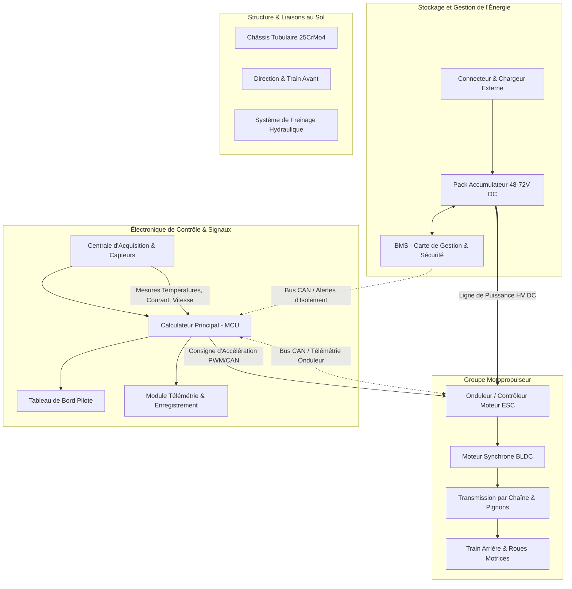

# Architecture Globale

## Vue d'Ensemble Système

Le système **e-Kart** est modélisé comme un ensemble mécatronique fermé où coexistent deux réseaux de distribution de puissance (haute et basse tension) ainsi qu'un réseau décentralisé de données et de commande temps réel.

## Diagramme Fonctionnel d'Interconnexion



## Matrice des Interfaces Système

| Interface | Émetteur $\to$ Récepteur | Domaine | Caractéristiques physiques / Protocole |
|:---|:---|:---:|:---|
| Ligne de puissance HV | Batterie $\to$ ESC | Électrotechnique | $48 - 72 \text{ V DC}$, courant nominal $120 \text{ A}$, crête $250 \text{ A}$ |
| Alimentation auxiliaire BT | Convertisseur DC-DC $\to$ MCU/Capteurs | Électronique | $12{,}0 \text{ V DC}$ régulé, $5 \text{ A}$ max, protection par fusible |
| Supervision batterie | BMS $\to$ MCU | Communication | Bus CAN 2.0B à $500 \text{ kbps}$ (tensions cellules, SoC, SoH, $T^\circ$) |
| Commande moteur | MCU $\to$ ESC | Commande | Signal analogique redondant ($0 - 5 \text{ V}$) ou trame CAN périodique ($50 \text{ Hz}$) |
| Retour d'état moteur | ESC $\to$ MCU | Diagnostic | Température bobinage, courant efficace, vitesse de rotation RPM |
| Consigne pilote | Pédale d'accélérateur $\to$ MCU | Capteur | Double capteur à effet Hall indépendant (sécurité anti-patinage) |
| Bus d'instrumentation | Capteurs $\to$ MCU | Mesure | Bus I2C / SPI / Entrées analogiques 12 bits |
| Lien de télémétrie | MCU $\to$ Poste Stand | Sans fil | Émetteur WiFi / LoRa $868 \text{ MHz}$ pour analyse à distance |

## Bilan et Flux de Puissance

```mermaid
sankey-beta
    Pack Batterie, Onduleur ESC, 95
    Onduleur ESC, Pertes Onduleur, 4
    Onduleur ESC, Moteur Synchrone, 91
    Moteur Synchrone, Pertes Joule & Fer, 8
    Moteur Synchrone, Transmission Chaine, 83
    Transmission Chaine, Pertes Mécaniques, 3
    Transmission Chaine, Puissance aux Roues, 80
    Pack Batterie, Convertisseur DC-DC, 5
    Convertisseur DC-DC, Électronique de Commande, 4.5
    Convertisseur DC-DC, Pertes Conversion, 0.5
```

## Contraintes Transverses d'Ingénierie

!!! warning "Exigences de Sécurité et de Compatibilité"
    1. **Séparation Galvanique et CEM** : Les câbles de puissance transportant des courants modulés à haute fréquence ($10 - 20 \text{ kHz}$) sont blindés et physiquement séparés d'au moins $100 \text{ mm}$ des lignes de signaux sensibles.
    2. **Régime Thermique** : Le dimensionnement assure une température stabilisée inférieure à $55^\circ\text{C}$ sur les cellules de batterie, $70^\circ\text{C}$ sur l'onduleur et $90^\circ\text{C}$ au point chaud du stator moteur en conditions maximales.
    3. **Boucle de Verrouillage Haute Tension (HVIL)** : Tout débranchement accidentel d'un connecteur de puissance ou actionnement d'un arrêt coup de poing ouvre instantanément la bobine du contacteur principal.
