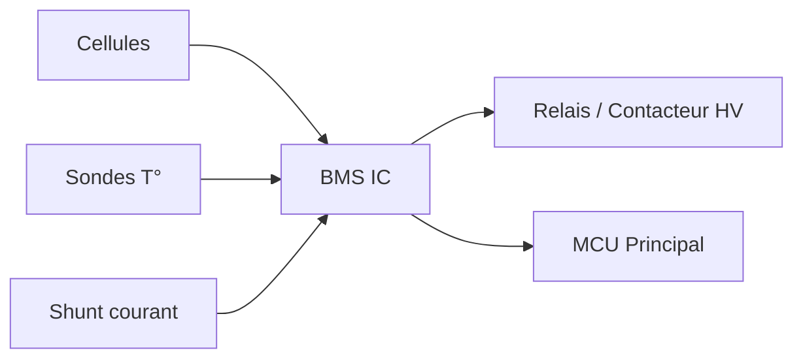

# BMS — Battery Management System

## Rôle du BMS

Le BMS est le gardien de la batterie. Il assure :

- :fontawesome-solid-shield-halved: **Protection** — Sur/sous-tension, sur-courant, sur-température
- :fontawesome-solid-scale-balanced: **Équilibrage** — Égalisation des tensions de cellules
- :fontawesome-solid-chart-line: **Monitoring** — SOC, SOH, courant, températures
- :fontawesome-solid-tower-broadcast: **Communication** — Remontée des données vers le MCU

## Architecture

## Choix du BMS

<!-- TODO: BMS du commerce vs BMS custom, critères de choix -->

## Paramétrage

<!-- TODO: Seuils de tension, courant, température -->

---

*Page à compléter.*
