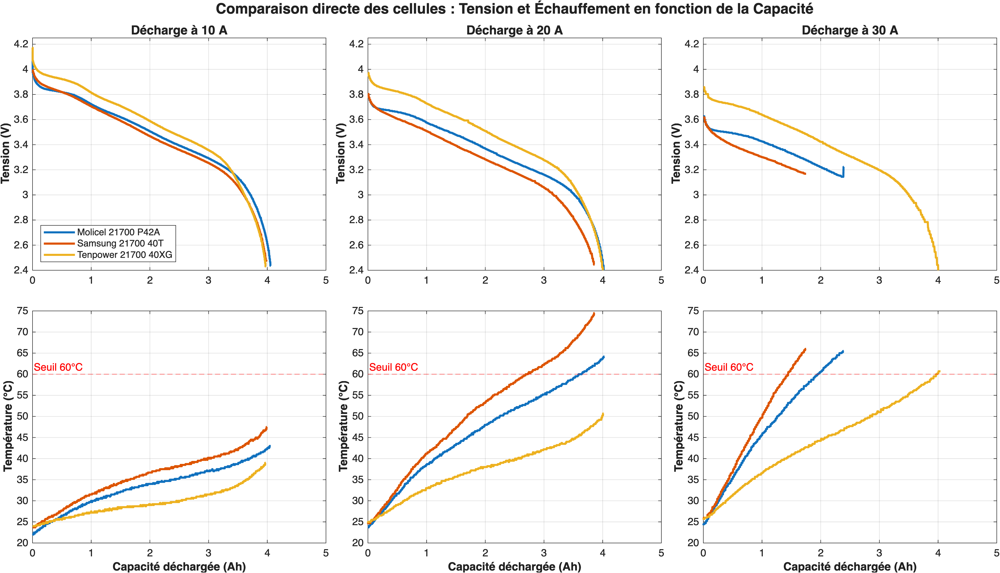
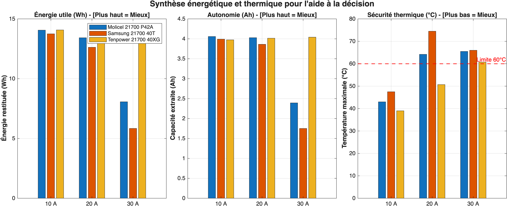
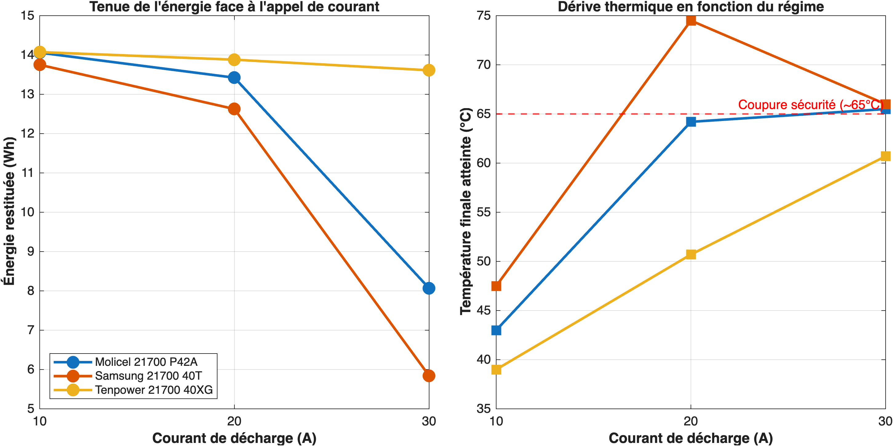

# Chimie & Cellules

## Étude Comparative des Technologies Électrochimiques

Le choix de la technologie d'accumulateur conditionne la densité énergétique, la stabilité thermique face au risque d'emballement et la durée de vie sous forts courants de décharge.

| Technologie | Tension nominale | Densité massique | Stabilité thermique | Durée de vie (cycles) | Coût relatif | Évaluation projet |
|:---|:---:|:---:|:---:|:---:|:---:|:---|
| **LiFePO4** (Lithium Fer Phosphate) | $3{,}2 \text{ V}$ | $140 - 170 \text{ Wh/kg}$ | Maximale ($T_{\text{runaway}} > 270^\circ\text{C}$) | Excellente ($> 3\,000$ cycles) | Modéré | **Recommandé pour la sécurité et la robustesse** |
| **NMC** (Nickel Manganèse Cobalt) | $3{,}7 \text{ V}$ | $220 - 260 \text{ Wh/kg}$ | Moyenne ($T_{\text{runaway}} \approx 210^\circ\text{C}$) | Bonne ($1\,000 - 1\,500$ cycles) | Élevé | Option haute performance si masse critique |
| **LTO** (Lithium Titanate) | $2{,}3 \text{ V}$ | $70 - 90 \text{ Wh/kg}$ | Maximale | Exceptionnelle ($> 15\,000$ cycles) | Très élevé | Écarté : masse excessive pour l'énergie requise |

## Comparatif des Formats Géométriques

=== "Cellules Cylindriques (21700 / 18650)"
    - **Avantages** : Standard industriel éprouvé, disponibilité immédiate, excellente dissipation thermique surfacique, fusibles internes de surpression (CID).
    - **Procédé d'assemblage** : Soudage par points (spot welding) de bandes de cuivre/nickel pur sur gabarit isolé imprimé en 3D (PETG ignifugé).
    - **Applications cibles** : Packs haute puissance nécessitant des décharges crêtes supérieures à $30 \text{ A}$ par élément.

=== "Cellules Prismatiques"
    - **Avantages** : Forte capacité unitaire ($30 - 100 \text{ Ah}$), réduction drastique du nombre de connexions (16 cellules pour un pack 16S1P), bornes vissées M6/M8.
    - **Inconvénients** : Nécessite une mise sous compression mécanique contrôlée ($300 \text{ kgf}$) pour éviter le gonflement au cyclage.
    - **Applications cibles** : Packs de grande autonomie privilégiant la simplicité d'intégration mécanique.

=== "Cellules Poches (Pouch Cells)"
    - **Avantages** : Compacité extrême, absence de boîtier lourd, très faible résistance série équivalente (ESR).
    - **Inconvénients** : Vulnérabilité mécanique aux perforations, déformation sous gazage, contraintes sévères de bridage.
    - **Applications cibles** : Compétition de pointe sous réserve d'un confinement structurel étanche.

## Tableau Comparatif des Références Candidates

| Référence commerciale | Format | Chimie | Capacité | Tension nom. | Décharge | Prix (en 05/26) | Masse |
|:---|:---:|:---:|---:|---:|---:|---:|---:|
| **Molicel INR-21700-P42A** | 21700 | NMC | $4{,}2 \text{ Ah}$ | $3{,}6 \text{ V}$ | $30 \text{ A}$ (crête $45 \text{ A}$) | $2{,}99 \text{€}$ | $68 \text{ g}$ |
| **Samsung INR-21700-40T** | 21700 | NMC | $4{,}0 \text{ Ah}$ | $3{,}6 \text{ V}$ | $30 \text{ A}$ (crête $45 \text{ A}$) | $2{,}99 \text{€}$ | $70 \text{ g}$ |
| **Tenpower INR21700-40XG** | 21700 | NMC | $4{,}0 \text{ Ah}$ | $3{,}6 \text{ V}$ | $30 \text{ A}$ (crête $45 \text{ A}$) | $3{,}15 \text{€}$ | $70 \text{ g}$ |

## Décision Technique et Justification

Le dimensionnement de référence s'oriente vers une architecture **16S LiFePO4 prismatique** ($50 \text{ Ah}$ nominal) ou une variante **14S8P en cellules cylindriques 21700 NMC (Molicel P42A)**. La variante prismatique LiFePO4 est privilégiée pour sa sécurité supérieure en phase d'essais préliminaires et son nombre réduit d'interconnexions électriques.

# Rapport de Caractérisation et Sélection des Cellules Lithium-Ion 21700

> **Résumé exécutif** — Ce document présente les résultats de la campagne de caractérisation électro-thermique menée sur trois références de cellules cylindriques au format 21700 : **Molicel P42A**, **Samsung 40T** et **Tenpower 40XG**. À l'issue des essais de décharge continue à 10 A, 20 A et 30 A, la cellule **Tenpower 21700 40XG** est retenue pour le dimensionnement du pack batterie en raison de sa tenue en tension supérieure et de sa maîtrise thermique à haute puissance.

---

## 1. Contexte et Protocole Expérimental

L'objectif de cette étude est d'identifier la cellule offrant le meilleur compromis entre densité énergétique utile (Wh), tenue en puissance (chute ohmique réduite) et sécurité thermique sous forte sollicitation.

### 1.1 Panel de cellules évaluées

Les trois cellules candidates appartiennent à la catégorie *High-Power* au format 21700 (21 mm de diamètre, 70 mm de longueur) :

* **Molicel INR-21700-P42A** : Référence historique pour les applications à fort courant de décharge, dotée d'une capacité nominale de 4,2 Ah.
* **Samsung INR21700-40T** : Cellule de puissance standard de 4,0 Ah à faible impédance.
* **Tenpower INR21700-40XG** : Cellule de 4,0 Ah de nouvelle génération intégrant une architecture interne *tabless* (collecteur de courant continu sans languette), conçue pour minimiser la résistance électrique et thermique.

### 1.2 Conditions de test

Chaque cellule a été soumise à un protocole de décharge à courant constant (CC) après une charge complète à 4,2 V :
* **Paliers de courant testés** : 10 A (~2,5C), 20 A (~5C) et 30 A (~7,5C).
* **Tension de coupure basse (*cut-off*)** : 2,4 V.
* **Sécurité thermique du banc** : Coupure automatique programmée autour de 65 °C sur la voie de sécurité principale.
* **Fréquence d'échantillonnage** : 2 Hz ($\Delta t = 0,5\text{ s}$).

> **Note sur l'instrumentation thermique** : Lors des essais à 10 A et 20 A, le thermocouple de peau de la cellule était raccordé sur l'entrée auxiliaire (`temp A`), n'entraînant pas d'arrêt automatique par le banc au-delà de 65 °C. Pour l'essai à 30 A, la sonde a été basculée sur la voie de sécurité active (`temp 1`), déclenchant une coupure matérielle dès l'atteinte du plafond thermique (~65 °C).

---

## 2. Analyse des Profils de Décharge ($U$ et $T$ vs Capacité)

La figure ci-dessous compare directement la tension aux bornes des cellules et l'élévation de leur température de surface en fonction de la capacité extraite (Ah) pour chaque régime de décharge.

<figure markdown="span">
  { width="100%" }
  <figcaption>Figure 2.1 — Tension aux bornes et élévation thermique en fonction de la capacité extraite (10 A, 20 A et 30 A).</figcaption>
</figure>

### 2.1 Comportement électrique (Tenue en tension)

1. **Chute ohmique initiale ($\Delta U = R_{DC} \cdot I$)** : Dès l'application du courant, la **Tenpower 40XG** présente une chute de tension nettement plus faible que ses concurrentes. À 30 A, sa tension se stabilise initialement autour de **3,80 V**, contre **3,55 V** pour la Molicel P42A et **3,50 V** pour la Samsung 40T.
2. **Maintien du plateau de tension** : Sur l'ensemble de la décharge (10 A, 20 A et 30 A), la courbe de la Tenpower 40XG domine de **150 mV à 250 mV** celles des deux autres cellules. À puissance électrique constante demandée par le système, une tension plus haute permet d'abaisser le courant appelé.

### 2.2 Comportement thermique (Pertes par effet Joule)

La puissance thermique générée au cœur de la cellule répondant au premier ordre à la loi $P_{th} = R_{interne} \cdot I^2$, la hiérarchie des résistances internes se retrouve directement sur les courbes d'échauffement :

* **À 10 A** : Les trois cellules restent dans une plage de fonctionnement nominale (< 48 °C). La Tenpower 40XG affiche déjà l'échauffement le plus faible (39 °C en fin de décharge contre 47,5 °C pour la Samsung 40T).
* **À 20 A** : L'écart se creuse fortement. La Tenpower 40XG termine sa décharge complète à **50,7 °C**, restant largement sous le seuil critique de 60 °C. À l'inverse, la Molicel P42A franchit ce seuil en fin de cycle (**64,2 °C**) et la Samsung 40T subit un emballement thermique important atteignant **74,5 °C**.
* **À 30 A** : La génération de chaleur devient limitante pour les architectures classiques. La Samsung 40T et la Molicel P42A atteignent la limite de sécurité de **65 °C** avant d'avoir pu restituer toute leur charge, provoquant l'arrêt prématuré du test à respectivement **1,75 Ah** et **2,40 Ah**. Seule la **Tenpower 40XG** parvient au terme de sa décharge complète (**4,04 Ah**) avec une température finale contenue à **60,7 °C**.

---

## 3. Synthèse Énergétique et Autonomie

Afin de quantifier la performance globale à l'échelle système, les grandeurs intégrées (Énergie restituée en Wh, Capacité extraite en Ah et Température maximale atteinte) sont regroupées sur le graphique suivant.

<figure markdown="span">
  { width="100%" }
  <figcaption>Figure 3.1 — Synthèse comparative de l'énergie restituée (Wh), de la capacité extraite (Ah) et de la température maximale atteinte.</figcaption>
</figure>

### Tableau récapitulatif des performances mesurées

| Cellule | Régime | Capacité extraite (Ah) | Énergie utile (Wh) | Température max (°C) | Statut de fin d'essai |
| :--- | :---: | :---: | :---: | :---: | :--- |
| **Molicel 21700 P42A** | 10 A | **4,05 Ah** | 14,05 Wh | 43,0 °C | Décharge complète ($U_{min}$) |
| **Samsung 21700 40T** | 10 A | 3,99 Ah | 13,75 Wh | 47,5 °C | Décharge complète ($U_{min}$) |
| **Tenpower 21700 40XG** | 10 A | 3,97 Ah | **14,08 Wh** | **39,0 °C** | Décharge complète ($U_{min}$) |
| **Molicel 21700 P42A** | 20 A | **4,02 Ah** | 13,43 Wh | 64,2 °C | Décharge complète ($T > 60\text{ °C}$) |
| **Samsung 21700 40T** | 20 A | 3,86 Ah | 12,63 Wh | 74,5 °C | Décharge complète (Surchauffe) |
| **Tenpower 21700 40XG** | 20 A | 4,01 Ah | **13,89 Wh** | **50,7 °C** | Décharge complète ($U_{min}$) |
| **Molicel 21700 P42A** | 30 A | 2,39 Ah | 8,06 Wh | 65,5 °C | **Coupure thermique (59 % SoC)** |
| **Samsung 21700 40T** | 30 A | 1,75 Ah | 5,84 Wh | 66,0 °C | **Coupure thermique (44 % SoC)** |
| **Tenpower 21700 40XG** | 30 A | **4,04 Ah** | **13,62 Wh** | **60,7 °C** | Décharge complète ($U_{min}$) |

> **Enseignement clé (Ah vs Wh)** : Bien que la Molicel P42A restitue légèrement plus de capacité coulombique à 10 A (4,05 Ah contre 3,97 Ah pour la Tenpower), la **Tenpower 40XG délivre davantage d'énergie utile (14,08 Wh)** grâce à sa tension moyenne plus élevée.

---

## 4. Tenue aux Forts Courants et Déclassement

L'analyse du déclassement énergétique en fonction de l'appel de courant met en évidence la robustesse de chaque chimie et design mécanique face aux régimes sévères.

<figure markdown="span">
  { width="100%" }
  <figcaption>Figure 4.1 — Déclassement de l'énergie utile et dérive thermique en fonction de l'intensité de décharge continue.</figcaption>
</figure>

* **Stabilité énergétique exceptionnelle de la Tenpower 40XG** : Entre 10 A et 30 A, l'énergie restituée par la Tenpower passe de **14,08 Wh à 13,62 Wh**, soit une perte négligeable de seulement **3,3 %** lorsque le courant est triplé.
* **Effondrement par limitation thermique des cellules standard** : Sans refroidissement actif, la Molicel P42A perd **42 %** de son énergie exploitable à 30 A, et la Samsung 40T en perd **58 %** en raison de l'atteinte rapide du plafond thermique de sécurité.

---

## 5. Conclusion et Décision d'Architecture

L'analyse croisée des données expérimentales conduit à un classement sans appel pour notre application :

1. **Choix retenu : Tenpower 21700 40XG**
   * **Justification** : Son architecture *tabless* réduit drastiquement la résistance interne. C'est la seule cellule du panel capable de soutenir une décharge continue de 30 A jusqu'à épuisement complet de sa capacité (~4,0 Ah) tout en maintenant sa température à ~60 °C. À 20 A, elle offre une marge de sécurité thermique de plus de **13,5 °C** par rapport à la Molicel P42A, garantissant une durée de vie (cyclage) accrue et un besoin de refroidissement réduit.
2. **Solution de repli (Back-up) : Molicel 21700 P42A**
   * **Justification** : Excellente capacité à bas et moyen régime (10 A - 15 A), mais nécessite un bridage logiciel du courant ou un système de refroidissement thermique dimensionné si des appels continus supérieurs à 20 A sont envisagés.
3. **Cellule écartée : Samsung 21700 40T**
   * **Justification** : Résistance interne trop élevée entraînant des pertes par effet Joule prohibitives dès 20 A (74,5 °C) et une chute de tension pénalisante pour le rendement du système.
