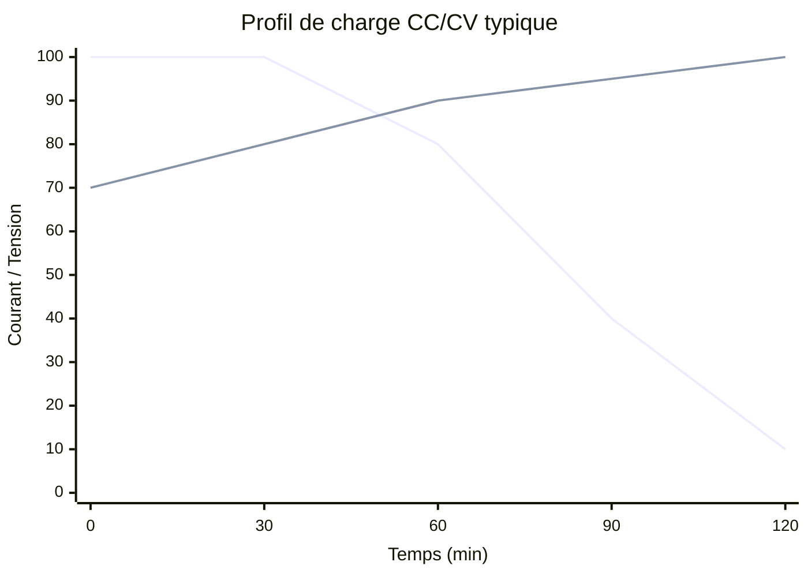

# Charge & Autonomie

## Chargeur

<!-- TODO: Choix du chargeur, courant de charge, protocole CC/CV -->

## Profil de charge

## Estimation de l'autonomie

<!-- TODO: Calcul basé sur l'énergie du pack et la consommation estimée -->

## Connecteur de charge

<!-- TODO: Type de connecteur, sécurité, verrouillage -->

---

*Page à compléter.*
