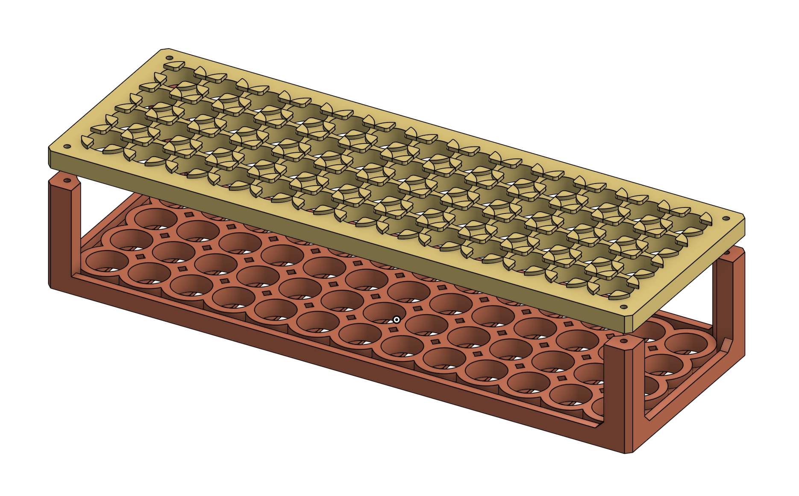
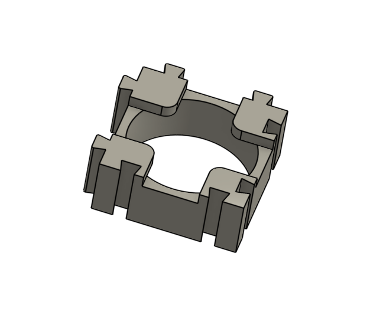
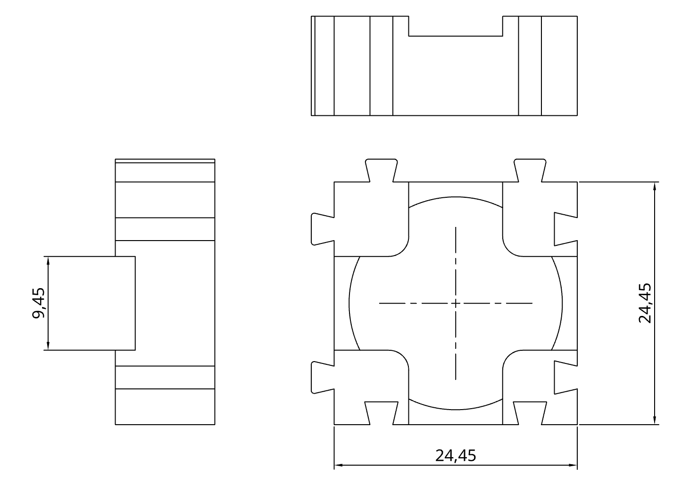
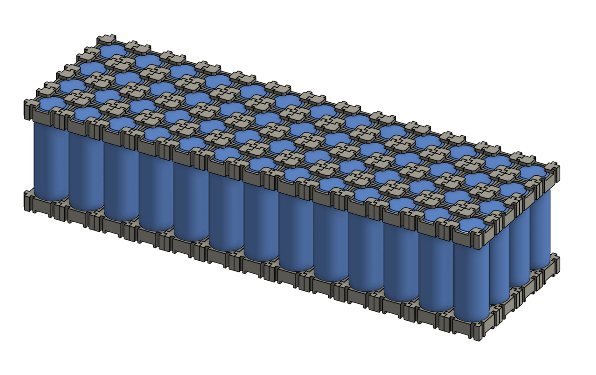
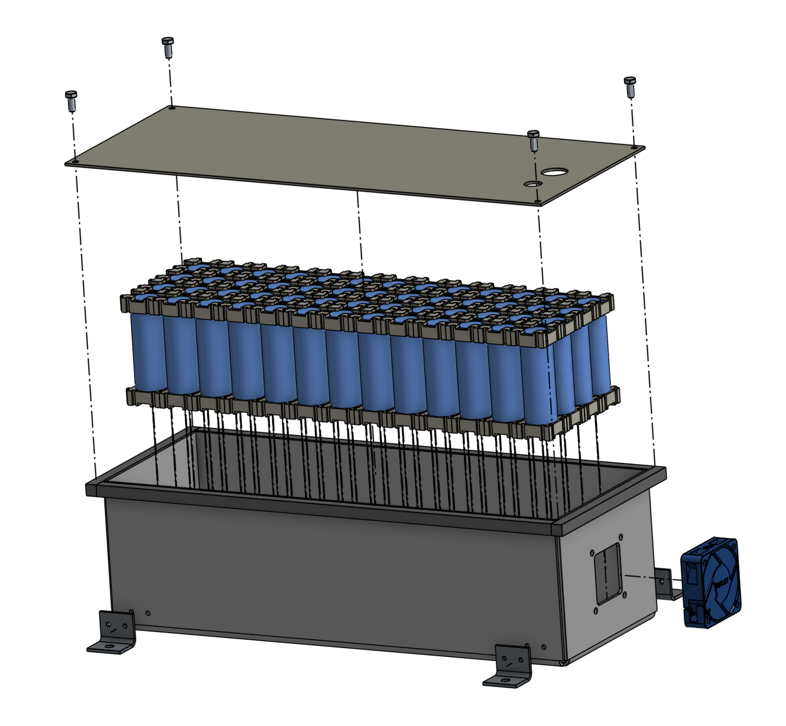
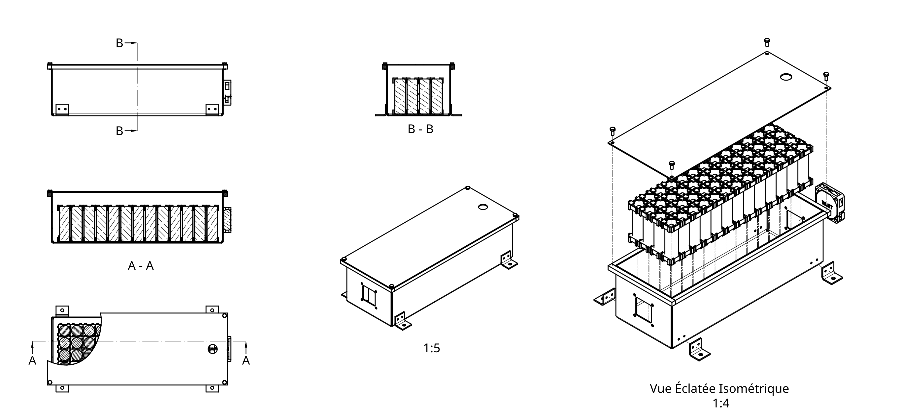

# Architecture du Pack

## Configuration série/parallèle

La tension et la capacité du pack sont déterminées par la configuration des cellules.

$$
V_{pack} = n_s \times V_{cellule}
$$

$$
C_{pack} = n_p \times C_{cellule}
$$

$$
E_{pack} = V_{pack} \times C_{pack}
$$

| Paramètre | Formule | Valeur | Grandeur Physique |
|:---|:---|:---|:---|
| Cellules en série (nS) | \( V_{cible} / V_{cellule} \) | 13S | 46,8 V |
| Cellules en parallèle (nP) | \( C_{cible} / C_{cellule} \) | 4P | 16,8 Ah |
| Nombre total de cellules | \( n_s \times n_p \) | 52 | 895 Wh |

## Conception du pack

La batterie est constituée de **52 cellules** regroupées dans un pack. Elles sont maintenues par des spacers et soudées par points à l'aide de bandes de nickel. Ce pack est protégé par un boîtier métallique.

Par mesure de sécurité, le boîtier doit être totalement isolé électriquement des cellules. Un indice de protection IP54 (protection contre les poussières et les projections d'eau de toutes directions) est visé afin de garantir un fonctionnement en extérieur.

### Spacers de cellules

Pour maintenir les cellules solidaires entre elles, assurer leur espacement et les disposer selon la géométrie souhaitée, des entretoises (*spacers*) sont utilisées.

Une première version a été modélisé, elle présentait cependant plusieurs inconvénients. Sa taille l'empêchait d'être imprimé facilement, et sa conception rendait les dimensions (lignes x colonnes) fixes. Ainsi il n'est pas possible faire une autre disposition sans avoir à reimprimer les spacers. 

<figure markdown="span">
  { width="100%" }
  <figcaption>Figure 1 — Modèle CAO de la première version monobloc du spacer.</figcaption>
</figure>

Une seconde version a donc été conçue afin de pallier les défauts de la première : les pièces sont désormais modulaires et s'emboîtent entre elles (voir Figures 2 et 3), offrant une grande flexibilité pour obtenir l'architecture géométrique souhaitée.

Ce caractère modulaire a pour contrepartie de rendre la structure initiale un peu moins rigide. Cette souplesse est toutefois compensée lors de l'assemblage par l'isolation et l'ajout de ruban adhésif renforcé en fibre de verre.

Les pièces sont imprimées en PETG afin d'éviter de dépasser la température de transition vitreuse et de garantir la rigidité et la résistance mécanique face aux échauffements.

<figure markdown="span">
  
  <figcaption>Figure 2 — Modèle CAO de la seconde version du spacer unitaire emboîtable.</figcaption>
</figure>

<figure markdown="span">
  
  <figcaption>Figure 3 — Dessin de définition 2D du spacer V2.</figcaption>
</figure>

L'agencement en 3D de l'assemblage complet des cellules au sein des spacers V2 est illustré ci-dessous (voir Figure 4).

<figure markdown="span">
  { width="100%" }
  <figcaption>Figure 4 — Modèle CAO de l'assemblage des 52 cellules avec les spacers V2.</figcaption>
</figure>

### Boîtier

Le boîtier remplit plusieurs fonctions essentielles : il protège la batterie contre les chocs mécaniques, la poussière, les éclaboussures et les éventuels débris de piste. Il garantit également la sécurité des utilisateurs en isolant électriquement les cellules de l'environnement extérieur.

La conception s'est orientée vers un boîtier en tôle d'acier pliée puis soudée. Des ouvertures sont aménagées dans la longueur afin de pouvoir loger un ventilateur et une grille d'aération.

La fixation du couvercle a nécessité une attention particulière : il fallait qu'il soit solidement fixé, facilement démontable et qu'il assure une étanchéité satisfaisante. La solution retenue consiste à créer des rebords périphériques afin d'offrir un appui-plan continu sur lequel le couvercle vient reposer. Des barres en acier plein sont vissées sur les bords avec des vis à tête fraisée pour ne créer aucune surépaisseur, puis des trous taraudés permettent de fixer le couvercle démontable.

La soudure avait été initialement envisagée pour ces barres, mais pour éviter toute déformation thermique de la tôle fine sur les bords et pour garantir un plan de joint parfaitement plat sans surépaisseur de cordon, la fixation mécanique vissée a été privilégiée.

La fixation au châssis est assurée par des pattes en tôle d'acier pliée. Elles sont positionnées et maintenues par des vis temporaires, puis soudées au boîtier. Les vis sont ensuite retirées pour qu'aucune saillie ne dépasse à l'intérieur du compartiment batterie.

<figure markdown="span">
  { width="100%" }
  <figcaption>Figure 5 — Vue éclatée de l'ensemble du pack batterie (cellules, boîtier, couvercle et fixations).</figcaption>
</figure>

<figure markdown="span">
  { width="100%" }
  <figcaption>Figure 6 — Plan d'ensemble coté de l'assemblage du pack batterie.</figcaption>
</figure>

### Isolation électrique

L'isolation électrique est une barrière de sécurité indispensable pour éviter tout court-circuit interne ou mise à la masse du châssis :

* **Anneaux en papier d'orge (*barley paper* / *fishpaper*)** : Chaque cellule 21700 reçoit une rondelle adhésive isolante en papier d'orge au niveau de sa borne positive. Comme le corps métallique entier de la cellule est relié au pôle négatif sous la fine gaine thermorétractable, ces rondelles garantissent qu'aucun contact accidentel ne puisse se produire entre la bande de nickel soudée et l'épaulement négatif, même sous fortes vibrations ou contraintes mécaniques.
* **Isolation des bandes de nickel** : Des bandes de papier d'orge autocollant et du ruban isolant haute température (Kapton) sont appliqués au-dessus des bandes de nickel et entre les liaisons série adjacentes. Cela prévient tout contact électrique involontaire entre potentiels différents.
* **Enveloppe globale et découplage mécanique** : Le bloc de cellules assemblé est recouvert d'une gaine thermorétractable en PVC, puis séparé des parois internes du boîtier en acier par des plaques isolantes en fibre et de la mousse d'amortissement dense pour absorber les chocs.

### Gestion thermique

L'un des facteurs limitants de la batterie est sa capacité à évacuer la chaleur pour ne pas provoquer un bridage de puissance, voire un arrêt d'urgence préventif contre l'emballement thermique.

Le besoin d'évacuer la chaleur se heurte à la contrainte prioritaire de l'isolation électrique : celle-ci confine le pack et empêche l'air de circuler directement entre les cellules. La ventilation (active ou passive) agit donc principalement en évacuant les calories dissipées dans le volume d'air périphérique du boîtier.

Néanmoins, un ventilateur d'extraction est installé sur le flanc du boîtier pour renouveler l'air chaud. Cette régulation active est asservie aux mesures acquises en temps réel par les sondes de température implantées au cœur des cellules et reliées au BMS.

!!! note "Ressources CAO et plans détaillés"
    Pour consulter et télécharger l'ensemble des plans de définition et modèles 3D (boîtier, couvercle, pattes de fixation, spacers), rendez-vous dans la [Médiathèque CAO](../../mediatheque/cao.md) et la section [Schémas & Datasheets](../../mediatheque/schemas.md).
