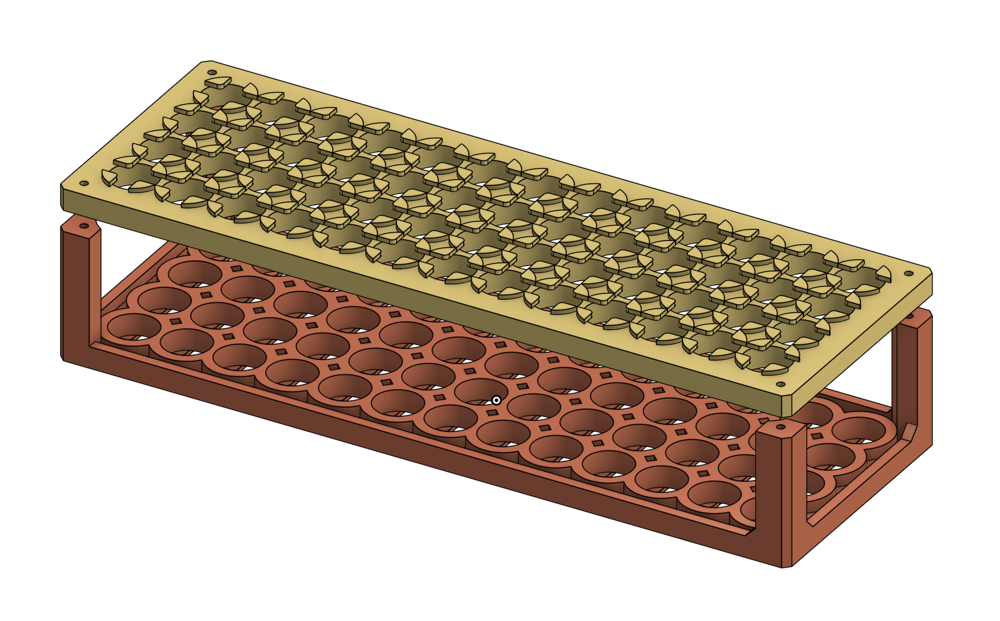
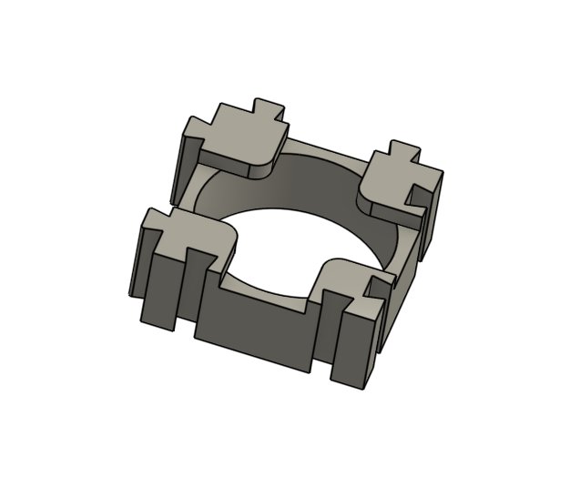
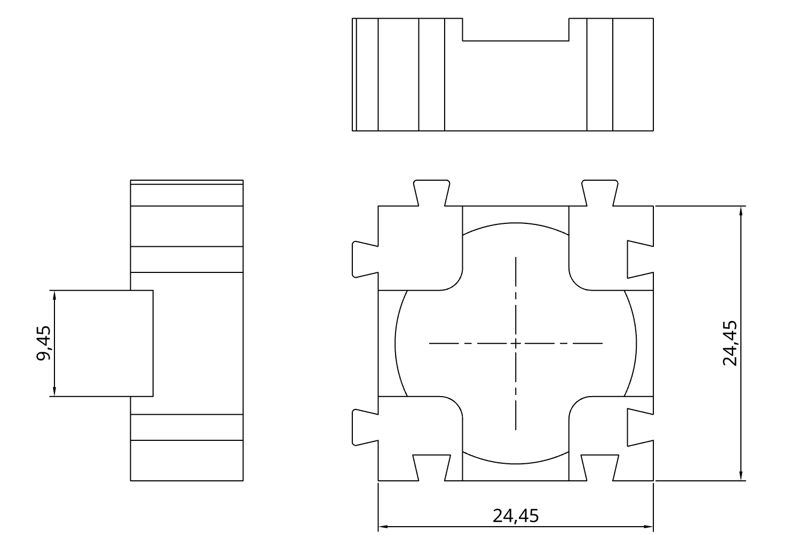
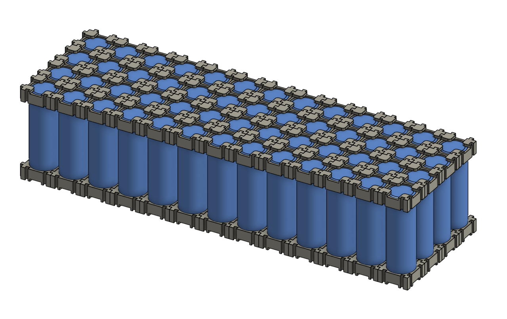
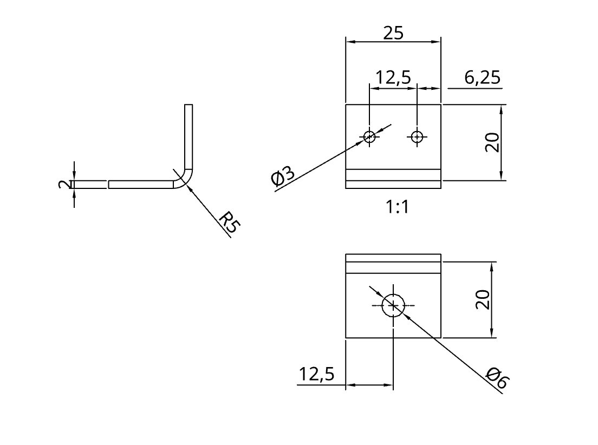
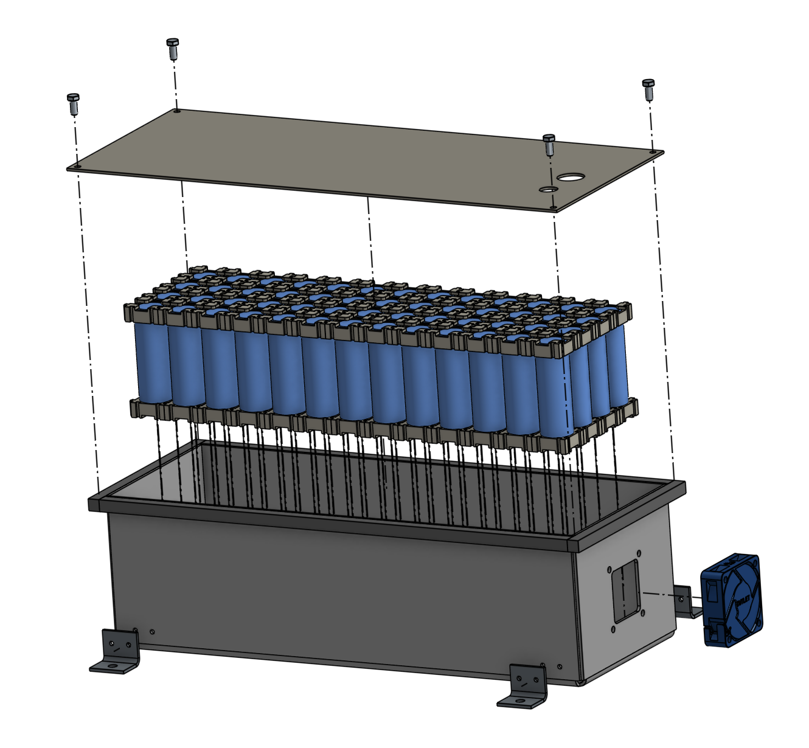
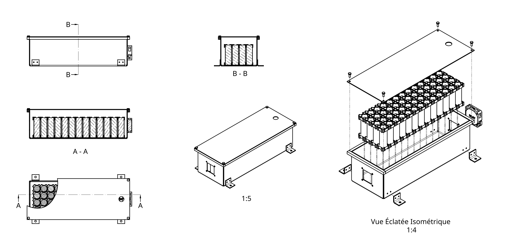

# Architecture du Pack

## Configuration série/parallèle

La tension et la capacité du pack sont déterminées par la configuration des cellules.

$$
V_{pack} = n_s \times V_{cellule}
$$

$$
C_{pack} = n_p \times C_{cellule}
$$

$$
E_{pack} = V_{pack} \times C_{pack}
$$

| Paramètre | Formule | Valeur | Grandeur Physique |
|:---|:---|:---|:---|
| Cellules en série (nS) | \( V_{cible} / V_{cellule} \) | 13S | 46,8 V |
| Cellules en parallèle (nP) | \( C_{cible} / C_{cellule} \) | 4P | 16,8 Ah |
| Nombre total de cellules | \( n_s \times n_p \) | 52 | 895 Wh |

## Conception du pack

La batterie est constituée de **52 cellules** regroupées dans un pack. Elles sont maintenues par des spacers et soudées par points à l'aide de bandes de nickel. Ce pack est protégé par un boîtier métallique.

Par mesure de sécurité, le boîtier doit être totalement isolé électriquement des cellules. Un indice de protection IP54 (protection contre les poussières et les projections d'eau de toutes directions) est visé afin de garantir un fonctionnement en extérieur.

### Spacers de cellules

Pour maintenir les cellules solidaires entre elles, assurer leur espacement et les disposer selon la géométrie souhaitée, des entretoises (*spacers*) sont utilisées.

Une première version a été modélisé, elle présentait cependant plusieurs inconvénients. Sa taille l'empêchait d'être imprimé facilement, et sa conception rendait les dimensions (lignes x colonnes) fixes. Ainsi il n'est pas possible faire une autre disposition sans avoir à reimprimer les spacers. 

<figure markdown="span">
  { width="100%" }
  <figcaption>Figure 1 — Modèle CAO de la première version monobloc du spacer.</figcaption>
</figure>

Une seconde version a donc été conçue afin de pallier les défauts de la première : les pièces sont désormais modulaires et s'emboîtent entre elles (voir Figures 2 et 3), offrant une grande flexibilité pour obtenir l'architecture géométrique souhaitée.

Ce caractère modulaire a pour contrepartie de rendre la structure initiale un peu moins rigide. Cette souplesse est toutefois compensée lors de l'assemblage par l'isolation et l'ajout de ruban adhésif renforcé en fibre de verre.

Les pièces sont imprimées en PETG afin d'éviter de dépasser la température de transition vitreuse et de garantir la rigidité et la résistance mécanique face aux échauffements.

<figure markdown="span">
  
  <figcaption>Figure 2 — Modèle CAO de la seconde version du spacer unitaire emboîtable.</figcaption>
</figure>

<figure markdown="span">
  
  <figcaption>Figure 3 — Dessin de définition 2D du spacer V2.</figcaption>
</figure>

L'agencement en 3D de l'assemblage complet des cellules au sein des spacers V2 est illustré ci-dessous (voir Figure 4).

<figure markdown="span">
  { width="100%" }
  <figcaption>Figure 4 — Modèle CAO de l'assemblage des 52 cellules avec les spacers V2.</figcaption>
</figure>

### Boîtier Métallique et Étanchéité IP54

Le boîtier loge et protège le pack de 52 cellules d'accumulateurs. Sa conception répond à un cahier des charges strict articulé autour de quatre exigences directrices :

1. **Protection environnementale IP54** : Barrière hermétique contre les poussières et les projections d'eau directes en conditions extérieures.
2. **Fabricabilité en atelier sans déformation thermique** : Mise en œuvre de procédés maîtrisés par les techniciens d'atelier (validation conjointe avec M. Schalck).
3. **Démontabilité et maintenabilité rapide** : Accès intégral au pack d'accumulateurs en quelques minutes sans outillage spécialisé.
4. **Dissipation thermique** : Évacuation continue des calories dissipées pour préserver la durée de vie électrochimique des cellules.

#### Conception Mécano-Pliée et Soudabilité

Le caisson est fabriqué à partir de tôle d'acier découpée puis pliée avant soudage. Afin de prévenir tout vrillage ou gauchissement thermique de la tôle fine qui détruirait la planéité du plan de joint, **les opérations de pliage ont été maximisées pour remplacer les cordons de soudure continus**. Les quelques soudures résiduelles sont strictement localisées et discontinues pour minimiser l'énergie de soudage apportée.

#### Interface Boîtier / Couvercle et Rebords d'Étanchéité

Pour garantir la compression uniforme d'un joint d'étanchéité périphérique (joint élastomère silicone ou caoutchouc) et satisfaire l'indice **IP54**, la planéité du plan de joint est déterminante :

* **Rebords d'appui rigides en tube plein** : Les portées d'étanchéité sont réalisées avec des barres en tube carré d'acier plein de **$8 \times 8 \text{ mm}$**. Ces barres apportent une assise indéformable sur tout le pourtour supérieur du caisson.
* **Choix du vissage plutôt que du soudage** : L'inertie thermique des barres pleines de $8 \text{ mm}$ est considérablement plus forte que celle de la tôle pliée. Un soudage direct provoquerait un retrait différentiel important au refroidissement, déformant irréversiblement les flancs du caisson. Les rebords sont donc **vissés au boîtier par vis à tête fraisée**, assurant une planéité rigoureuse tout en restant remplaçables en cas de dégradation.
* **Fixation et démontabilité du couvercle** : Le couvercle supérieur est fixé par **4 à 6 vis M4** taraudées directement dans la matière pleine des rebords de $8 \text{ mm}$. Ce taraudage en acier massif garantit un couple de serrage et une résistance à l'arrachement impossibles à obtenir dans de la tôle fine, tout en autorisant une dépose complète en moins de 3 minutes.

#### Fixation au Châssis en Deux Temps (Sécurité Électrique)

Le caisson est ancré aux longerons tubulaires du châssis par **4 pattes en tôle d'acier pliée**. L'intégration s'effectue selon une procédure rigoureuse en deux étapes :

1. **Positionnement et calage géométrique par vissage** : Les pattes sont pré-assemblées par vissage pour ajuster précisément l'assiette du boîtier, le centrage des masses et les jeux avec la colonne de direction et le baquet.
2. **Soudage définitif sur châssis** : Une fois la géométrie validée, les pattes sont pointées puis soudées à l'arc/TIG sur les tubes du châssis.
3. **Retrait impératif des vis de pointage** : Les vis de positionnement sont systématiquement dévissées et retirées. Ce choix découle d'un impératif absolu de **sécurité électrique** : des tiges filetées en saillie à l'intérieur du caisson présenteraient un risque critique de frottement, d'abrasion de la gaine isolante et de court-circuit direct avec les pôles des cellules.

<figure markdown="span">
  
  <figcaption>Figure 5 — Dessin de définition 2D de la patte de fixation du boîtier (tôle d'acier pliée).</figcaption>
</figure>

<figure markdown="span">
  
  <figcaption>Figure 6 — Vue éclatée de l'ensemble du pack batterie (cellules, boîtier, couvercle et fixations).</figcaption>
</figure>

<figure markdown="span">
  { width="100%" }
  <figcaption>Figure 7 — Plan d'ensemble coté de l'assemblage complet du pack batterie et de son caisson.</figcaption>
</figure>

### Isolation Électrique Interne

L'isolation électrique est une barrière de sécurité indispensable pour éviter tout court-circuit interne ou mise à la masse du châssis :

* **Anneaux en papier d'orge (*barley paper* / *fishpaper*)** : Chaque cellule 21700 reçoit une rondelle adhésive isolante en papier d'orge au niveau de sa borne positive. Comme le corps métallique entier de la cellule est relié au pôle négatif sous la fine gaine thermorétractable, ces rondelles garantissent qu'aucun contact accidentel ne puisse se produire entre la bande de nickel soudée et l'épaulement négatif, même sous fortes vibrations ou contraintes mécaniques.
* **Isolation des bandes de nickel** : Des bandes de papier d'orge autocollant et du ruban isolant haute température (Kapton) sont appliqués au-dessus des bandes de nickel et entre les liaisons série adjacentes. Cela prévient tout contact électrique involontaire entre potentiels différents.
* **Enveloppe globale et découplage mécanique** : Il reste encore à déterminer si le bloc de cellules assemblé sera recouvert d'une gaine thermorétractable en PVC. Cela réduirait évidemment les risques de court-circuit mais compliquera l'évacuation de la chaleur. Les cellules ont déjà une enveloppe et seront éloignées du boîtier. Il faudra donc voir quel est le plus grand risque en le thermique et l'électrique.
Le pack est séparé des parois internes du boîtier en acier par des cales imprimées en TPU aux quatres coins et de la mousse d'amortissement dense pour absorber les chocs.

### Gestion Thermique et Refroidissement Convectif

Le dimensionnement thermique du pack a fait l'objet d'une modélisation multiphysique sous Simulink / Simscape :

* **Comportement thermique validé** : Lors d'un roulage continu de plus de $1\,000\text{ s}$ sous un débit nominal de $42\text{ A}$, la température du pack s'élève de $20^\circ\text{C}$ pour se stabiliser entre $37^\circ\text{C}$ et $38^\circ\text{C}$ (et $45^\circ\text{C}$ en continu ininterrompu), restant très éloignée de la zone critique ($80^\circ\text{C}$) ou de la zone de coupure ($65^\circ\text{C}$).
* **Ventilation active redondante** : Bien que la convection naturelle et l'inertie du pack suffisent à éviter tout emballement thermique, le boîtier intègre un emplacement usiné pour un **ventilateur axial à extraction forcée** et une grille d'aération périphérique filtrée, garantissant un balayage d'air permanent et une sécurité en plus contre l'emballement thermique.

!!! note "Ressources CAO et plans détaillés"
    Pour consulter et télécharger l'ensemble des plans de définition et modèles 3D (boîtier, couvercle, pattes de fixation, spacers), rendez-vous dans la [Médiathèque CAO](../../mediatheque/cao.md) et la section [Schémas & Datasheets](../../mediatheque/schemas.md).

