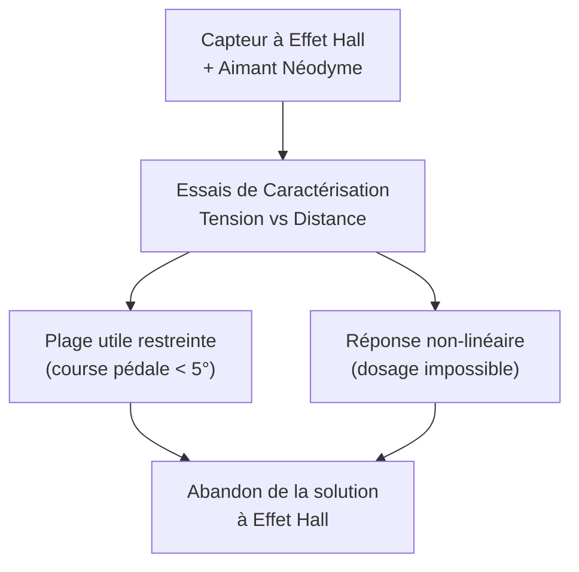
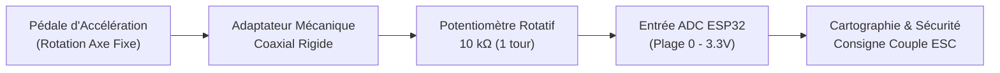

# Freinage & Pédalier

Le poste de pilotage intègre deux commandes fondamentales aux pieds : la pédale de freinage hydraulique agissant sur l'arbre arrière et la pédale d'accélération transmettant la consigne de couple au calculateur embarqué (ESP32).

---

## 1. Pédale d'Accélération et Capteur de Consigne

### Analyse Critique et Abandon du Capteur à Effet Hall

Dans la phase de pré-dimensionnement, la mesure de position de la pédale d'accélération avait été envisagée au moyen d'un **capteur à effet Hall linéaire** couplé à un aimant néodyme solidaire de la pédale mobile, le capteur étant monté sur un support fixe du châssis. La rotation de la pédale devait rapprocher l'aimant et faire varier le champ magnétique détecté.

Une campagne de caractérisation expérimentale (relevé de la tension analogique en fonction de l'entrefer aimant-capteur) a mis en évidence deux limites physiques rédhibitoires :

1. **Course angulaire exploitable extrêmement étroite** : La zone de sensibilité exploitable du champ magnétique ne correspond qu'à quelques millimètres de translation relative, soit une course angulaire de seulement **quelques degrés** au niveau de la pédale. Cette hypersensibilité rendait le dosage de l'accélération imprécis et le pilotage brutal, avec un risque permanent de perte d'adhérence au démarrage.
2. **Non-linéarité prononcée de la réponse** : La tension de sortie décroît de façon exponentielle avec la distance. Obtenir une consigne proportionnelle à l'enfoncement aurait nécessité une interpolation logicielle lourde et un étalonnage sensible aux dérives thermiques et aux vibrations de l'aimant.

### Étude Comparative des Solutions Potentiométriques

Pour remplacer l'effet Hall, une acquisition par potentiomètre a été étudiée afin de mesurer directement le déplacement de la pédale :

| Technologie étudiée | Avantages mécaniques | Inconvénients / Risques | Décision technique |
|:---|:---|:---|:---:|
| **Potentiomètre linéaire à glissière** | Déplacement progressif sur course longue | Nécessite un mécanisme de transformation rotation $\to$ translation (biellette, chapes), encombrement accru, jeux et frottements parasites | **Écarté** |
| **Potentiomètre rotatif $10\text{ k}\Omega$ 1 tour** | Rotation directe concordant avec le pivot de pédale, compacité, fiabilité | Nécessite un guidage coaxial rigide | **Retenu** |

Le composant sélectionné est un **potentiomètre rotatif linéaire de $10\text{ k}\Omega$ (1 tour)**. Alimenté entre $0\text{ V}$ et $3{,}3\text{ V}$, il délivre une tension de curseur comprise entre ces deux seuils. Ce signal est directement injecté sur une entrée analogique ADC de l'ESP32 **sans nécessiter de pont diviseur de tension**, éliminant un étage de composants passifs et sécurisant l'entrée du microcontrôleur contre toute surtension.

### Transmission Mécanique Pédale $\to$ Potentiomètre

Deux cinématiques de liaison ont été évaluées :

1. **Transmission par câble déporté sous gaine** : Un câble d'accélérateur relié à une poulie sur l'axe du potentiomètre avec ressort de rappel de torsion. Bien qu'offrant une liberté de positionnement du composant, cette option introduit des frottements mécaniques, des risques d'usure ou d'effilochage du câble, une hystérésis mécanique et un réglage délicat de la prétension. Elle a été **écartée**.
2. **Entraînement direct coaxial (Solution retenue)** : Le potentiomètre est aligné directement sur l'axe de pivotement de la pédale via un **adaptateur mécanique sur mesure**. Lorsque le pilote appuie sur la pédale, celle-ci pivote autour de son axe fixe et transmet intégralement la rotation au curseur sans aucun composant intermédiaire.

**Bénéfices de l'architecture coaxiale :**

* Jeu mécanique nul et absence d'hystérésis à l'actionnement.
* Compacité maximale dans le pédalier avant.
* Protection mécanique et réduction drastique des pièces mobiles d'usure.

### Sécurité Logicielle et Détection de Défauts (Fail-Safe)

L'ESP32 implémente une routine de validation de plage de tension à chaque cycle d'échantillonnage ($50\text{ Hz}$) :

$$
V_{\text{min, sécurité}} \le V_{\text{pot}} \le V_{\text{max, sécurité}} \quad \text{avec} \quad [0{,}2\text{ V} ; 3{,}1\text{ V}]
$$

* Si $V_{\text{pot}} < 0{,}2\text{ V}$ (rupture d'un conducteur ou déconnexion du curseur) : passage immédiat en consigne d'accélération nulle ($0\%$).
* Si $V_{\text{pot}} > 3{,}1\text{ V}$ (court-circuit avec la ligne d'alimentation) : coupure d'urgence de la consigne.
* Étalonnage dynamique des butées mécaniques de repos ($0\%$) et de plein gaz ($100\%$) pour exploiter toute la course utile du pied du pilote.

---

## 2. Système de Freinage Hydraulique Arrière

### Architecture Mécanique

Conformément aux règlements de karting de compétition, le système de freinage agit directement sur l'arbre arrière monobloc en acier de $\varnothing 30\text{ mm}$ :

* **Disque de frein** : Disque ventilé en fonte d'acier ou acier allié, usiné avec des perçages radiaux pour optimiser le refroidissement convectif et limiter le fading lors des freinages répétés.
* **Moyeu porte-disque** : Pièce usinée en aluminium 6061-T6, bridée sur l'arbre de transmission par serrage transversal fendu avec clavetage de sécurité.
* **Étrier de frein** : Étrier hydraulique flottant à double piston opposé en alliage léger.
* **Maître-cylindre** : Commande directe par biellette rigide depuis la pédale de freinage gauche, équipée d'un ressort de rappel mécanique indépendant.
* **Fluide hydraulique** : Liquide de frein haute température **DOT 4 / DOT 5.1** (point d'ébullition sec $> 260^\circ\text{C}$).

### Dimensionnement de l'Effort de Freinage

Pour un véhicule de masse totale $m = 300\text{ kg}$ (kart + pilote + pack batterie) roulant à sa vitesse maximale $v_0 = 60\text{ km/h}$ ($16{,}67\text{ m/s}$), la décélération cible minimale est fixée à $a_{\text{frein}} = 1{,}0\text{ g} \approx 9{,}81\text{ m/s}^2$.

La force de freinage totale tangentielle aux roues arrière vaut :

$$
F_{\text{frein, roues}} = m \times a_{\text{frein}} = 300 \times 9{,}81 = 2\,943\text{ N}
$$

Le couple de freinage requis sur l'arbre arrière, pour un rayon sous charge de pneu $R_{\text{roue}} \approx 0{,}13\text{ m}$, s'établit à :

$$
C_{\text{arbre}} = F_{\text{frein, roues}} \times R_{\text{roue}} = 2\,943 \times 0{,}13 \approx 382{,}6\text{ N}\cdot\text{m}
$$

L'effort de serrage hydraulique est dimensionné pour délivrer ce couple sur le rayon effectif du disque ($R_{\text{disque}} \approx 0{,}085\text{ m}$) avec un coefficient de frottement garniture/disque $\mu \approx 0{,}38$.

### Sécurité Positive et Priorité du Freinage

La pédale de frein intègre un capteur de fin de course mécanique (contact sec) ou un pressostat hydraulique monté sur le circuit :

!!! danger "Coupure de Traction Prioritaire"
    Tout actionnement de la pédale de frein est directement routé vers la boucle d'arrêt d'urgence et lu par l'ESP32. En cas d'appui simultané sur le frein et l'accélérateur, **l'injection de couple moteur est instantanément écrasée à $0\text{ N}\cdot\text{m}$**, évitant toute surcharge du moteur électrique et assurant la distance d'arrêt la plus courte.
