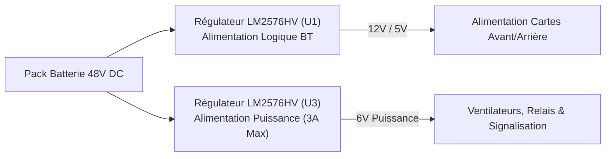

# Schéma Électrique & Cartes Électroniques (PCB)

L'architecture électronique du kart e-Kart est structurée autour d'une distribution de puissance à deux niveaux de tension ($48\text{ V}$ nominal de traction et bus auxiliaire basse tension) couplée à un réseau de communication numérique temps réel **Bus CAN 2.0B** reliant deux calculateurs maîtres **ESP32** (Carte Avant et Carte Arrière).

---

## 1. Synoptique Général de Puissance et de Commande

```mermaid
flowchart TD
    subgraph PUISSANCE["Chaîne de Puissance Haute Tension (48V)"]
        BAT["Pack Batterie Molicel 14S4P<br/>(48V Nom. - Cellules 21700)"] --> FUSE["Fusible Général HV<br/>(200A Type gBat)"]
        FUSE --> PRECHG["Circuit de Précharge<br/>(Résistance 100Ω / Relais)"]
        PRECHG --> CONTACTOR["Contacteur Principal HV<br/>(Normalement Ouvert)"]
        CONTACTOR --> ESC["Onduleur / Variateur FOC"]
        ESC --> MOT["Moteur Synchrone 3-4 kW<br/>(Phases Triphasées U, V, W)"]
    end

    subgraph DISTRIBUTION["Carte Distribution de Puissance"]
        BAT ==>|Alimentation 48V| PCB_POW["Carte de Puissance Dédiée<br/>(Hacheurs LM2576HV CMS)"]
        PCB_POW -->|Régulation 12V Logique| BUS_12V["Ligne 12V Auxiliaire"]
        PCB_POW -->|Régulation 6V Éclairage| BUS_6V["Ligne 6V Commutée"]
        PCB_POW -->|Shunt / Capteur Hall| CURR_SENS["Mesure Globale Courant"]
    end

    subgraph CONTROL["Architecture Électronique Embarquée (PCB)"]
        PCB_FRONT["Carte Avant (Cockpit)<br/>ESP32 + TFT + SD + Pédale 10kΩ"]
        PCB_REAR["Carte Arrière (Puissance & Sécurité)<br/>ESP32 + MOSFETs CMS + IMU"]
        PCB_LEDS["Carte Signalisation Arrière<br/>LEDs Stop & Clignotants"]
        
        PCB_FRONT <==>|Bus CAN 2.0B (GPIO 6 & 7)| PCB_REAR
        PCB_REAR -->|Commande MOSFET 6V| PCB_LEDS
        PCB_REAR -->|Pilotage Bobine| CONTACTOR
        PCB_REAR -->|Consigne PWM / CAN| ESC
    end
```

---

## 2. Conception et Spécifications des 4 Cartes PCB

À l'issue de la phase d'expérimentation en atelier, quatre circuits imprimés spécifiques ont été développés et optimisés sous Proteus :

### A. Carte Avant (Supervision Pilote & Poste de Conduite)

* **Rôle fonctionnel** : Centralisation des commandes du cockpit (consigne d'accélération, sélecteur de mode, boutons poussoirs), acquisition du capteur laser de distance, écriture des données sur carte SD et pilotage de l'écran couleur TFT.
* **Architecture microcontrôleur** : Microcontrôleur **ESP32** 32 bits dual-core.
* **Optimisations et modifications de routage** :
    1. **Déplacement du transceiver CAN sur GPIO 6 et GPIO 7** : Les broches initialement allouées entraient en conflit avec les lignes de téléversement série (UART Bootloader), bloquant la programmation du microcontrôleur. La migration sur les GPIO 6 et 7 libère les canaux de programmation et sécurise le démarrage sans glitch sur le bus CAN.
    2. **Suppression du pont diviseur résistif de la pédale** : À la suite de l'abandon du capteur à effet Hall au profit d'un potentiomètre rotatif $10\text{ k}\Omega$ alimenté directement sous la référence $3{,}3\text{ V}$ de l'ESP32, le pont diviseur résistif a été retiré. Le signal analogique de course ($0 - 3{,}3\text{ V}$) est acheminé directement à l'ADC sans chute de tension ni risque de surtension destructive.
    3. **Calibrage des pistes et vias** : Élargissement des pistes de signaux analogiques sensibles et pose d'un plan de masse continu pour blinder l'ADC contre le bruit rayonné par l'écran TFT.

### B. Carte Arrière (Contrôle Puissance, Sécurité Passive & Capteurs)

* **Rôle fonctionnel** : Commande des étages de commutation de puissance, acquisition télémétrique embarquée (centrale inertielle IMU 6 axes, sondes de température PT100/NTC, vitesse de roue), gestion de la boucle de sécurité et pilotage des actionneurs.
* **Architecture microcontrôleur** : Microcontrôleur **ESP32** esclave dédié à la puissance.
* **Optimisations et modifications de routage** :
    1. **Migration CAN sur GPIO 6 et 7** : Alignement rigoureux avec la carte avant pour standardiser le brochage et éviter tout blocage du téléversement firmware.
    2. **Migration vers des MOSFETs CMS** : Remplacement de l'ensemble des MOSFETs de puissance traversants (TO-220) par des boîtiers CMS (DPAK / D2PAK). Ce choix élimine les pattes traversantes inductives, optimise l'encombrement vertical et autorise une soudure industrielle fiable.
    3. **Correction de l'empreinte Proteus** : L'empreinte générique de la bibliothèque ne correspondait pas fidèlement aux boîtiers physiques approvisionnés. Une empreinte CAO sur mesure a été dessinée et validée en vue 3D pour garantir la coplanarité du plan de brasure.
    4. **Élargissement des vias et pistes de masse** : Multiplication des vias de liaison entre couches pour abaisser la résistance série équivalente (ESR) des retours de puissance.

### C. Carte Distribution de Puissance (Conversion 48V & Régulation)

* **Rôle fonctionnel** : Abaissement de la tension nominale du pack d'accumulateurs ($48\text{ V}$ continu) vers les tensions auxiliaires de commande ($12\text{ V}$, $6\text{ V}$, $3{,}3\text{ V}$) et mesure globale du courant de décharge.
* **Composants clés** : Hacheurs abaisseurs à découpage **LM2576HV** en boîtier CMS, capables d'encaisser des tensions d'entrée jusqu'à $60\text{ V}$.
* **Optimisations CEM et réduction du bruit** :
    1. **Boucles de commutation ultra-compactes** : Réagencement de l'implantation des puces LM2576HV, des inductances de lissage et des condensateurs de découplage CMS à très faible ESR. La surface des boucles $di/dt$ à haute fréquence est minimisée, éliminant les inductances parasites de maille et le bruit de rebond de masse (*Ground Bounce*).
    2. **Plans de puissance en polygone de cuivre** : Remplacement de toutes les pistes d'alimentation par de larges zones de cuivre massif (épaisseur $35\text{ µm}$ ou $70\text{ µm}$), réduisant la résistance ohmique et les chutes de tension.
    3. **Routage préconisé constructeur** : Implantation en étoile des masses et séparation nette entre masse logique et masse de commutation de puissance.



#### Bilan Thermique sans Radiateur Externe

Une analyse thermique détaillée a été menée pour valider le refroidissement passif des régulateurs LM2576HV (U1 et U3) :

* **Technologie retenue** : Dissipation par plans de cuivre double face interconnectés par une matrice dense de vias thermiques sous le *thermal pad* des composants CMS.
* **Résistance thermique équivalente** : La résistance thermique jonction-air est abaissée à :
  $$
  R_{\text{th}, j-a} = 32\text{ °C/W}
  $$
* **Comportement en conditions extrêmes ($T_{\text{amb}} = 40^\circ\text{C}$)** :

| Régulateur | Fonction | Courant débité | Température de jonction calculée ($T_j$) | Marge de sécurité vs limite constructeur ($110^\circ\text{C}$) |
|:---|:---|:---:|:---:|:---:|
| **U1** | Alimentation logique continue | $< 1\text{ A}$ | **$65{,}9^\circ\text{C}$** | Marge de $+44{,}1^\circ\text{C}$ |
| **U3** | Circuit de puissance auxiliaire | $3\text{ A}$ (pleine charge) | **$83{,}3^\circ\text{C}$** | Marge de $+26{,}7^\circ\text{C}$ |

Ces températures démontrent que les puces opèrent en deçà du seuil limite admissible de $110^\circ\text{C}$, confirmant qu'**aucun radiateur thermique externe en aluminium n'est requis**, procurant un gain d'espace et de masse significatif.

### D. Carte Satellite des Feux Stop et Clignotants

* **Rôle fonctionnel** : Signalisation lumineuse arrière réglementaire (feu stop rouge haute intensité, clignotant gauche et clignotant droit orange).
* **Architecture découplée** :
    1. **Carte déportée** : Implantation d'un PCB satellite compact directement fixé sur la traverse arrière du châssis, au plus près des optiques. Le faisceau est réduit à une liaison simple à deux conducteurs ($6\text{ V}$ commuté et masse).
    2. **Commande en tension découplée** : La commutation de puissance est prise en charge par un MOSFET installé sur la carte arrière. Aucun courant de LED ne transite par l'ESP32, qui ne délivre qu'un ordre logique à haute impédance.
    3. **Topologie redondante à deux branches parallèles** : Chaque fonction lumineuse comprend deux branches parallèles identiques. Chaque diode LED CMS possède sa propre résistance série calibrée. Cette conception garantit un équilibrage parfait des courants et maintient la visibilité de la fonction lumineuse même en cas de défaillance ou de coupure d'une LED.
    4. **Routage Proteus 2 couches** : Larges pastilles thermiques pour le transfert calorifique des LEDs, perçages de fixation $\varnothing 3{,}2\text{ mm}$ pour montage rigide sur châssis avec amortisseurs antivibratiles.

---

## 3. Validation sur Maquette d'Essai et Firmware

Les prototypes ont été validés sur plaquette d'essai (*breadboard*) :

* **Bus CAN 2.0B inter-ESP32** : Validation de l'échange bidirectionnel de trames à $500\text{ kbps}$ sur les broches GPIO 6 et 7. Une bibliothèque de trames propriétaire standardise les identifiants CAN (ID consigne couple, ID télémétrie batterie, ID alarmes de sécurité).
* **Affichage TFT couleur** : Initialisation SPI de l'écran, affichage graphique de la vitesse, de la tension de batterie et de la jauge d'état de charge (SoC).
* **Fabrication physique** : Les typons et fichiers Gerber de l'ensemble des 4 cartes ont été transmis au fabricant pour gravure industrielle. L'approvisionnement des composants CMS et traversants est complet pour le brasage dès réception.
