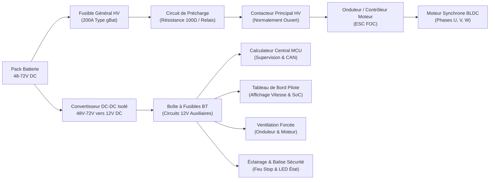
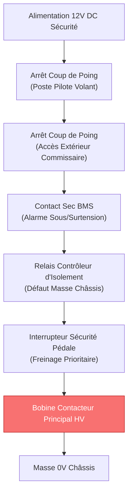

# Schéma Électrique Général

## Synoptique de la Chaîne de Puissance Haute Tension

Le circuit haute tension (HV) alimente l'onduleur de traction depuis le pack d'accumulateurs. La chaîne de distribution intègre un fusible pyrotechnique / cartouche ultrarapide, un contacteur de puissance et une résistance de précharge.

## Distribution Basse Tension (Réseau 12V DC)

Le réseau basse tension alimente l'ensemble de l'instrumentation et des organes de sécurité. Il est galvaniquement isolé du bus continu haute tension par un transformateur haute fréquence interne au convertisseur DC-DC.

| Circuit auxiliaire | Calibre fusible | Section conducteur | Organe alimenté |
|:---|:---:|:---:|:---|
| Ligne 1 — Calculateur central | $3 \text{ A}$ | $0{,}75 \text{ mm}^2$ | MCU, récepteur télémétrie, capteur pédale |
| Ligne 2 — Tableau de bord | $2 \text{ A}$ | $0{,}50 \text{ mm}^2$ | Écran TFT, boutons de commande, voyants |
| Ligne 3 — Bobine contacteur | $5 \text{ A}$ | $1{,}00 \text{ mm}^2$ | Bobine de maintien du contacteur principal HV |
| Ligne 4 — Refroidissement | $7{,}5 \text{ A}$ | $1{,}50 \text{ mm}^2$ | Ventilateurs axiaux PWM $12 \text{ V}$ |
| Ligne 5 — Feux de signalisation | $3 \text{ A}$ | $0{,}75 \text{ mm}^2$ | Feu stop arrière et indicateur d'isolement |

## Circuit de Sécurité et Boucle d'Arrêt d'Urgence

!!! danger "Fonctionnement en Sécurité Positive"
    La boucle d'arrêt d'urgence fonctionne selon le principe de la **sécurité positive** : la bobine du contacteur principal haute tension doit être continuellement alimentée pour maintenir le circuit fermé. Toute ouverture d'un contact (coup de poing pilote, coup de poing commissaire, alarme thermique BMS ou coupure d'isolement) provoque l'ouverture instantanée du contacteur par rappel mécanique à ressort.
