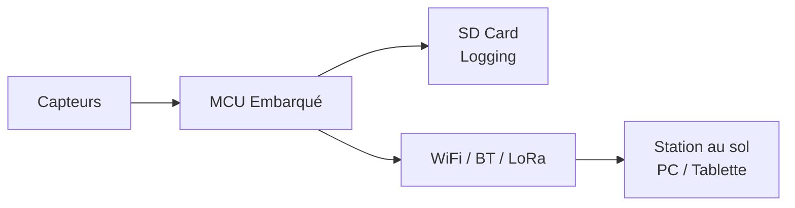

# Capteurs & Télémétrie

## Capteurs embarqués

| Capteur | Mesure | Interface | Modèle |
|:---|:---|:---|:---|
| Vitesse roue | km/h | Hall / Inductif | — |
| Température batterie | °C | NTC / I2C | — |
| Température moteur | °C | NTC / Thermocouple | — |
| Courant HV | A | Shunt / Hall | — |
| Tension batterie | V | ADC / BMS | — |
| Accéléromètre / Gyro | g / °/s | I2C (IMU) | — |
| GPS | Lat/Lon/Alt | UART | — |

## Architecture télémétrie

## Logging embarqué

<!-- TODO: Format de données, fréquence d'acquisition, stockage -->

## Station au sol

<!-- TODO: Application de visualisation temps réel -->

---

*Page à compléter.*
