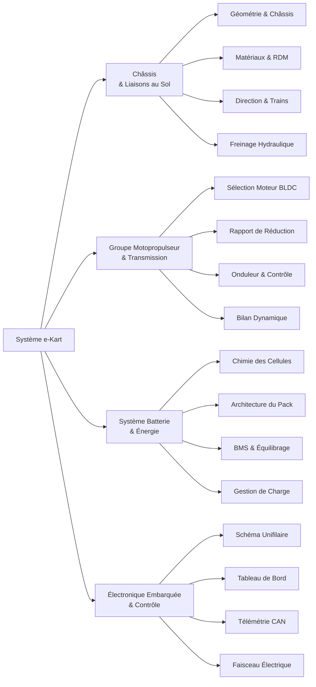

# Ingénierie & Conception

Cette section constitue le **cœur technique** du projet e-Kart. L'ingénierie du véhicule repose sur une décomposition fonctionnelle en sous-systèmes interdépendants, documentant le dimensionnement, les simulations numériques et les règles de l'art appliquées.

## Décomposition Fonctionnelle Système

## Navigation par Sous-Système

-   :fontawesome-solid-diagram-project:{ .lg .middle } __Architecture Globale__

    ---

    Matrice des flux d'énergie, synoptiques d'interconnexion, gestion thermique et règles de compatibilité électromagnétique.

    [:octicons-arrow-right-24: Consulter l'architecture](architecture.md)

-   :fontawesome-solid-car:{ .lg .middle } __Châssis & Mécanique__

    ---

    Structure tubulaire en acier 25CrMo4, géométrie d'épures de direction (Ackermann), trains roulants et dimensionnement du freinage.

    [:octicons-arrow-right-24: Consulter le châssis](chassis/index.md)

-   :fontawesome-solid-bolt:{ .lg .middle } __Groupe Motopropulseur__

    ---

    Moteur synchrone sans balais, onduleur de puissance, rapport de transmission cinématique et calculs de dynamique longitudinale.

    [:octicons-arrow-right-24: Consulter le motopropulseur](moteur/index.md)

-   :fontawesome-solid-battery-three-quarters:{ .lg .middle } __Batterie & Énergie__

    ---

    Sélection électrochimique des cellules, assemblage mécano-électrique du pack accumulateur, BMS communicant et protocole de charge.

    [:octicons-arrow-right-24: Consulter la batterie](batterie/index.md)

-   :fontawesome-solid-microchip:{ .lg .middle } __Électronique & Embarqué__

    ---

    Calculateur embarqué (MCU), faisceau de câblage basse tension, bus de données CAN, tableau de bord numérique et télémétrie sans fil.

    [:octicons-arrow-right-24: Consulter l'électronique](electronique/index.md)

## Spécifications Système de Référence

| Grandeur physique | Symbole | Valeur cible | Unité | Justification technique |
|:---|:---:|---:|:---:|:---|
| Masse totale à vide (hors pilote) | $m_{\text{vide}}$ | $\le 115$ | $\text{kg}$ | Répartition 42% AV / 58% AR |
| Masse totale en ordre de marche | $m_{\text{tot}}$ | $\le 190$ | $\text{kg}$ | Avec pilote équipé ($75 \text{ kg}$) |
| Vitesse maximale de pointe | $v_{\text{max}}$ | $\ge 65$ | $\text{km/h}$ | Rapport de réduction optimal sur circuit |
| Puissance nominale continue | $P_{\text{nom}}$ | $5{,}0$ | $\text{kW}$ | Régime thermique continu stabilisé |
| Puissance maximale crête (10 s) | $P_{\text{pic}}$ | $10{,}0$ | $\text{kW}$ | Phases d'accélération et dépassement |
| Tension nominale du bus DC | $V_{\text{bus}}$ | $51{,}2$ | $\text{V}$ | Configuration 16S LiFePO4 (ou 14S Li-ion) |
| Capacité nominale du pack | $E_{\text{pack}}$ | $2{,}5$ | $\text{kWh}$ | Compromis masse/autonomie ($> 25 \text{ km}$) |
| Accélération $0 \to 50 \text{ km/h}$ | $t_{0-50}$ | $\le 4{,}2$ | $\text{s}$ | Couple instantané dès les bas régimes |

!!! note "Ingénierie Système et Interfaces"
    Chaque sous-système est soumis à des contraintes croisées documentées dans la section [Architecture Globale](architecture.md). Les révisions de paramètres sont tracées via les fiches de synthèse de chaque domaine.
