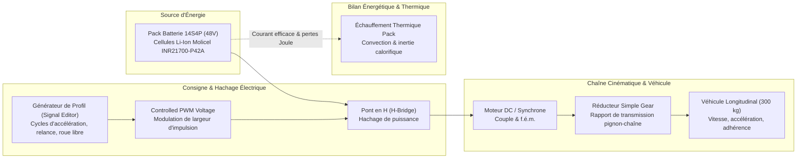
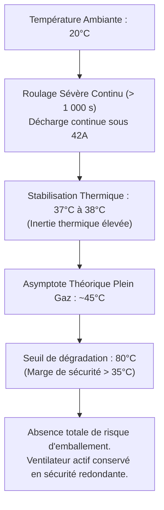

# Performances & Modélisation Multiphysique

Pour valider le comportement dynamique du kart, évaluer les transitoires électriques et dimensionner la thermique du groupe motopropulseur en conditions de roulage réalistes, un modèle multiphysique complet a été développé sous l'environnement **MATLAB / Simulink / Simscape**.

---

## 1. Modèle Dynamique du Véhicule

### Équations Fondamentales du Mouvement

L'effort de traction tangentiel développé aux roues motrices arrière $F_{\text{traction}}$ doit équilibrer la somme des forces résistantes appliquées au véhicule :

$$
F_{\text{traction}} = F_{\text{roulement}} + F_{\text{aéro}} + F_{\text{pente}} + m \, a
$$

$$
F_{\text{traction}} = C_{rr} \, m \, g \, \cos(\alpha) + \frac{1}{2} \, \rho \, C_x \, S \, v^2 + m \, g \, \sin(\alpha) + m \, \frac{\mathrm{d}v}{\mathrm{d}t}
$$

Pour une piste plane ($\alpha \approx 0^\circ$) et aux vitesses modérées rencontrées en essais de mise au point ($v \le 60\text{ km/h}$), la traînée aérodynamique demeure secondaire par rapport à l'inertie lors des fortes phases d'accélération. L'équation se simplifie ainsi :

$$
F_{\text{traction}} \approx m \, (C_{rr} \, g + a)
$$

Avec :

* $m = 300\text{ kg}$ : masse totale en ordre de marche (châssis, pilote équipé, pack batterie, moteur et instrumentation).
* $C_{rr} \approx 0{,}015$ : coefficient de résistance au roulement des pneumatiques de karting sur asphalte sec.
* $g = 9{,}81\text{ m/s}^2$ : accélération de la pesanteur.
* $a = \frac{\mathrm{d}v}{\mathrm{d}t}$ : accélération longitudinale du véhicule ($\text{m/s}^2$).

---

## 2. Architecture du Modèle Multiphysique Simulink / Simscape

Le modèle numérique couple la chaîne de commande électrique basse tension, l'étage de puissance, la cinématique mécanique et la thermique des cellules électrochimiques :

### Description des Blocs Simscape

1. **Générateur de profil (`Signal Editor`)** : Reproduit les sollicitations réelles du pilote en entrée de pédale (phases d'accélération progressive, maintien plein gaz, freinage et roue libre).
2. **Étage de découpage (`Controlled PWM Voltage` & `H-Bridge`)** : Module la tension continue issue de la batterie vers les enroulements statoriques avec un rendement de commutation représentatif.
3. **Moteur & Réducteur (`DC Motor` & `Simple Gear`)** : Modélise la constante de couple ($K_t$), la résistance d'induit et le rapport de réduction cinématique pour démultiplier le couple moteur vers l'arbre de transmission.
4. **Corps du véhicule (`Longitudinal Vehicle`)** : Intègre la masse inertielle de $300\text{ kg}$, le rayon sous charge des pneumatiques et la dynamique longitudinale.
5. **Pack Batterie Molicel 14S4P** : Modèle électrochimique couplé équivalent (résistance interne $R_i$, tension à vide OCV variable selon l'état de charge SoC) avec suivi thermique en continu.

---

## 3. Résultats et Analyse des Simulations Dynamiques

Deux profils de sollicitations ont été simulés : des cycles de pilotage intermittents (accélérations répétées) et un essai d'endurance sévère avec un appui continu à $100\%$ de consigne pendant **plus de $1\,000\text{ secondes}$** (environ $17\text{ minutes}$ à pleine puissance).

### A. Réponse en Tension et Comportement du Hachage

* **Transitoires d'enfoncement** : Lors de chaque sollicitation brutale de la pédale, la tension appliquée aux bornes du moteur présente des phénomènes de rebond transitoire amortis, caractéristiques de l'inductance de ligne et de la réponse de l'étage de filtrage.
* **Décharge du pack** : Sur l'essai longue durée, la tension moyenne décroît continûment en fonction de la vidange capacitaire de la batterie, passant de sa tension nominale ($51{,}8\text{ V}$ à pleine charge) vers sa tension de coupure, sans instabilité de régulation.

### B. Réponse en Courant

| Régime de fonctionnement | Courant instantané | Comportement physique |
|:---|---:|:---|
| **Appel de courant transitoire (démarrage / relance)** | **$50 \text{ A}$** | Pic d'intensité absorbé pour vaincre l'inertie du kart ($300\text{ kg}$) |
| **Régime établi continu (pleine charge)** | **$42 \text{ A}$** | Palier de courant nominal stabilisé sous traction continue |
| **Décroissance en fin de cycle** | $42 \to 38\text{ A}$ | Réduction progressive liée à la diminution de la force contre-électromotrice |

Les résultats confirment que le pack d'accumulateurs 14S4P débite ses **$42\text{ A}$ continus** de manière parfaitement stable, chaque branche parallèle de 4 cellules ne supportant que $10{,}5\text{ A}$ (valeur très conservatrice pour des cellules Molicel P42A certifiées à $45\text{ A}$ en continu).

---

## 4. Analyse Thermique et Validation de la Sécurité du Pack

L'enjeu prioritaire de la simulation multiphysique était de quantifier avec rigueur l'élévation thermique du pack de 52 cellules Molicel et de statuer sur le risque d'emballement thermique (*thermal runaway*) :

### Synthèse Thermique

1. **Cinétique d'échauffement** : Partant d'une température ambiante initiale de $20^\circ\text{C}$, la température interne du pack s'élève très progressivement grâce à la masse thermique élevée de l'ensemble (cellules, busbars nickel et spacers PETG).
2. **Palier de stabilisation** : Après plus de $1\,000\text{ secondes}$ d'accélération continue, la température se stabilise entre **$37^\circ\text{C}$ et $38^\circ\text{C}$**.
3. **Cas extrême d'accélération ininterrompue** : Même en poussant la simulation au-delà des conditions physiques envisageables en piste réelle (maintien permanent de la pédale à $100\%$), la température plafonne asymptotiquement aux alentours de **$45^\circ\text{C}$**.
4. **Marge de sécurité critique** : Le seuil critique de dégradation irréversible de l'électrolyte et de perte de capacité se situe vers **$80^\circ\text{C}$**. Le système conserve ainsi une marge thermique supérieure à **$35^\circ\text{C}$ à $43^\circ\text{C}$** en toute circonstance.

### Arbitrage sur le Refroidissement du Pack

La simulation multiphysique démontre qu'un système de refroidissement actif forcé externe n'est théoriquement pas requis pour préserver les cellules de toute surchauffe lors de runs normaux de karting.

Néanmoins, par mesure de **sécurité active redondante**, le boîtier métallique conserve son emplacement dédié pour un ventilateur d'extraction asservi, assurant un balayage d'air en cas de roulage prolongé sous forte canicule estivale ($T_{\text{amb}} \ge 40^\circ\text{C}$).
