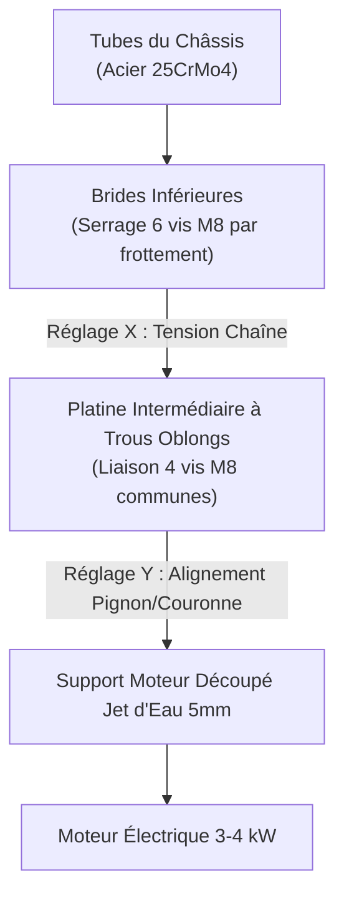

# Transmission & Support Moteur

## 1. Architecture et Justification de la Transmission

Pour relier l'arbre du moteur électrique ($3 \text{ à } 4 \text{ kW}$) à l'arbre arrière rigide, la transmission par **chaîne à rouleaux** a été sélectionnée face à une transmission par courroie crantée pour deux raisons mécaniques majeures :

1. **Suppression du risque de glissement sous fort couple** : Le moteur synchrone délivre un couple instantané élevé dès les bas régimes. Une courroie crantée risquerait le saut de dent lors des transitoires d'accélération violents.
2. **Encaissement des pics de courant au démarrage** : Les accélérations brutales génèrent des appels d'intensité atteignant jusqu'à $150 \text{ A}$. La liaison acier-acier d'une chaîne à rouleaux offre la résistance mécanique et la rigidité requises sans allongement élastique préjudiciable.

### Compromis Cinématique et Garde au Sol

La stratégie de pilotage privilégie les accélérations et les relances en sortie de virage, ce qui impose un rapport de réduction élevé, ciblé entre **$1:9$ et $1:10$**.

L'utilisation d'un pignon moteur standard du commerce ($11 \text{ à } 13 \text{ dents}$) aurait nécessité une couronne arrière de $90 \text{ à } 100 \text{ dents}$. Un tel diamètre primitif de couronne réduirait la garde au sol sous châssis à environ $7{,}5 \text{ cm}$, exposant dangereusement la couronne et la chaîne aux chocs sur les vibreurs et les irrégularités de la piste.

Afin de préserver une garde au sol sécurisée d'environ **$10{,}5 \text{ cm}$**, le diamètre de la couronne est bridé entre **$70 \text{ et } 80 \text{ dents}$**. L'atteinte du rapport de réduction cible a donc imposé la **conception sur mesure d'un pignon moteur ultra-compact de 9 dents ($z = 9$)**.

---

## 2. Conception Normée du Pignon Moteur (Norme NF E 26-102)

### Abandon de la Première Itération (V1)

Une première version du pignon de 9 dents avait été modélisée et mise en plan en atelier. L'analyse critique a toutefois conduit à son abandon : sa géométrie reposait sur un profil approché sans calcul rigoureux du profil d'engrènement. Sous un régime moteur élevé ($2\,000 \text{ W}$ continus, plus de $4\,000 \text{ tr/min}$), un profil non normé engendre un matage prématuré des maillons, une usure accélérée de la chaîne et un risque critique de déraillement sous charge dynamique.

### Calcul de la Nouvelle Denture selon ISO 606 / NF E 26-102

Le pignon a été intégralement recalculé pour le standard de compétition **Karting 219** (pas transversal $p = 7{,}774 \text{ mm}$, diamètre de rouleau $d_1 = 4{,}59 \text{ mm}$) selon les équations de la norme **NF E 26-102** :

| Grandeur géométrique | Formule normative | Valeur nominale | Tolérance de fabrication |
|:---|:---|:---:|:---:|
| **Nombre de dents ($z$)** | Cahier des charges cinématique | $9$ | — |
| **Pas de chaîne ($p$)** | Standard compétition 219 | $7{,}774 \text{ mm}$ | — |
| **Diamètre des rouleaux ($d_1$)** | Standard compétition 219 | $4{,}590 \text{ mm}$ | — |
| **Pas angulaire ($\theta$)** | $360^\circ / z$ | $40{,}0^\circ$ | Régulier |
| **Diamètre primitif ($d$)** | $\frac{p}{\sin(180^\circ / z)}$ | $22{,}73 \text{ mm}$ | Théorique |
| **Diamètre de fond de dent ($d_f$)** | Tolérance $[2{,}318 ; 2{,}433] \text{ mm}$ pour le rayon | $4{,}70 \text{ mm}$ ($r = 2{,}35 \text{ mm}$) | Centré en tolérance |
| **Diamètre extérieur ébauche ($d_a$)** | $d_a \le d + 1{,}25\,p - d_1$ | $28{,}0 \text{ mm}$ | $\pm 0{,}1 \text{ mm}$ |
| **Chanfreins d'entrée** | Guidage des plaques de maillons | $15^\circ$ sur $1{,}0 \text{ mm}$ | Usinage tournage |

* **Profil du creux de denture** : Usiné à un diamètre de $4{,}70 \text{ mm}$ ($r = 2{,}35 \text{ mm}$), centré dans la plage normative $[2{,}318 ; 2{,}433] \text{ mm}$, prévenant tout coincement ou arc-boutement des rouleaux au fond du creux.
* **Profil des flancs** : Déterminé par des centres de courbure disposés selon des angles de construction de $30^\circ$ et $60^\circ$ par rapport à l'axe radial, conférant un angle de pression optimal pour guider le rouleau sans frottement excessif.
* **Chanfreins de guidage** : Deux chanfreins symétriques de $15^\circ$ sur une profondeur de $1 \text{ mm}$ facilitent l'insertion axiale des maillons lors des déformations élastiques du châssis en virage.

!!! info "Statut de modélisation CAO"
    La modélisation de cette géométrie normée est en cours d'achèvement sous PTC Creo. La mise en plan définitive sera transmise à l'atelier pour usinage CNC dès validation du modèle numérique.

---

## 3. Support Moteur : Conception et Analyse par Éléments Finis (FEA)

### Rôle Mécanique et Géométrie

Le support moteur est une platine plane assurant la fixation du moteur aux brides qui sont elles-même fixées au châssis. Il doit support le couple électromagnétique ($3 \text{ à } 4 \text{ kW}$) et la transmission intégrale des efforts au cadre du châssis.

* **Matière** : Tôle d'acier de construction **S235** ($R_e \approx 235 \text{ MPa}$, $\rho = 7\,850 \text{ kg/m}^3$), épaisseur nominale **$5 \text{ mm}$**.
* **Masse calculée** : $0{,}634 \text{ kg}$.
* **Forme** : Découpe en « U inversé » épousant l'alésage central avec une largeur de matière constante, évitant les zones massives superflues tout en conservant une rigidité torsionnelle élevée.
* **Perçages** : 6 alésages au total — 4 pour la fixation de la bride moteur, 2 pour la liaison vissée aux équerres de maintien sur brides châssis.

<figure markdown="span">
  { width="80%" }
  <figcaption>Figure 1 — Dessin d'ensemble de système moteur, support, brides.</figcaption>
</figure>

### Modélisation et Conditions aux Limites (Creo Simulate Structure)

Une vérification par analyse statique linéaire a été conduite sous **PTC Creo Simulate Structure** :

* **Maillage** : Modèle 3D volumique solide comportant 264 éléments volumiques tétraédriques. L'épaisseur de $5 \text{ mm}$ rend le maillage volumique nettement plus fidèle qu'une modélisation en coques minces 2D.
* **Précision numérique** : L'erreur RMS sur les contraintes principales est de $4{,}6\%$ ($0{,}99 \text{ MPa}$ sur une contrainte maximale de $21{,}7 \text{ MPa}$), garantissant la convergence globale du calcul.
* **Conditions aux limites** : Encastrement rigide des deux perçages inférieurs (liaison aux équerres de fixation).
* **Cas de charge** : Application du couple moteur maximal pur. La résultante des forces est strictement nulle (de l'ordre de $10^{-11} \text{ N}$ selon X, Y et Z), représentative d'un couple mécanique pur auto-équilibré par les réactions aux appuis inférieurs.

### Résultats de la Simulation Statique

| Grandeur mécanique simulée | Valeur obtenue | Interprétation technique |
|:---|---:|:---|
| **Déplacement maximal (norme)** | $1{,}70 \times 10^{-2} \text{ mm}$ ($0{,}017 \text{ mm}$) | Déplacement négligeable ($< 0{,}02 \text{ mm}$) |
| **Composante dominante selon X (dans le plan)** | $-1{,}70 \times 10^{-2} \text{ mm}$ | Rotation globale dans le plan sous l'effet du couple |
| **Composante hors plan selon Y** | $1{,}30 \times 10^{-4} \text{ mm}$ | **$130\times$ plus faible** : absence de flexion hors plan |
| **Contrainte équivalente de Von Mises maximale** | $22{,}1 \text{ MPa}$ | Localisée en bordure des perçages inférieurs |
| **Contrainte principale maximale (traction $\sigma_1$)** | $17{,}2 \text{ MPa}$ | Très en deçà du seuil admissible |
| **Contrainte principale minimale (compression $\sigma_3$)** | $-21{,}7 \text{ MPa}$ | Niveaux symétriques cohérents avec un couple pur |
| **Cisaillement maximal ($\sigma_{xz}$)** | $11{,}8 \text{ MPa}$ | Cisaillement coplanaire maîtrisé |
| **Énergie de déformation élastique** | $2{,}5 \text{ mJ}$ | Rigidité structurelle excellente |

<figure markdown="span">
  { width="80%" }
  <figcaption>Figure 2 — Cartographie des déplacements sous Creo Simulate Structure (échelle déformée 1 186×). Déplacement maximal de 0,017 mm concentré sur l'arc supérieur.</figcaption>
</figure>

<figure markdown="span">
  { width="80%" }
  <figcaption>Figure 3 — Répartition des contraintes équivalentes de Von Mises. Pic maximal localisé à 22,1 MPa au niveau des perçages de fixation basse.</figcaption>
</figure>

### Analyse des Contraintes et Coefficient de Sécurité

1. **Coefficient de sécurité statique** : Avec une nuance S235 ($R_e = 235 \text{ MPa}$), le coefficient de sécurité élastique s'établit à :
   $$
   s = \frac{R_e}{\sigma_{\text{Von Mises, max}}} = \frac{235}{22{,}1} \approx 10{,}6
   $$
2. **Répartition des contraintes** :
   - *Corps principal* : Moins de $5 \text{ MPa}$ sur la majorité de la pièce (arc supérieur et zone centrale).
   - *Zone critique n°1 (Perçages bas)* : Pic localisé à $22{,}1 \text{ MPa}$ en bordure de trou reprenant la réaction au couple. Contrainte très inférieure à la limite de matage de l'acier doux ($p_{\text{adm}} \approx 120 \text{ MPa}$).
   - *Zone critique n°2 (Bordure d'alésage central)* : Lignes d'efforts de $8 \text{ à } 12 \text{ MPa}$ matérialisant le flux de cisaillement entre les points d'attache moteur et le châssis.
3. **Maintien de l'épaisseur de $5 \text{ mm}$** : Bien qu'une tôle de $3 \text{ mm}$ suffirait en statique pure, l'épaisseur de $5 \text{ mm}$ est conservée pour garantir la tenue à la fatigue vibratoire, encaisser les chocs de transmission et avoir une meilleure rigidité.

### Procédé de Fabrication : Découpe Jet d'Eau

La fabrication est confiée à l'atelier par **découpe au jet d'eau abrasif** (validée avec le responsable d'atelier, M. Schalck) :

- **Matière disponible** : Tôle acier S235 épaisseur $5 \text{ mm}$ déjà approvisionnée.
- **Dossier de fabrication** : Fichier d'usinage exporté au format `DXF 2D`. (à ajouter)

---

## 4. Fixation Réglable au Châssis (Ensemble Brides & Platine)

Pour compenser les tolérances de soudure du châssis et garantir un alignement géométrique parfait de la transmission, la liaison support-châssis intègre un **double réglage orthogonal bidirectionnel (X, Y)** :

### Cinématique des Réglages

1. **Réglage longitudinal selon X (Tension de la chaîne)** :
   - Assuré par le coulissement des brides sur les tubes longitudinaux du cadre.
   - Une fois la flèche de chaîne réglée ($10 \text{ à } 15 \text{ mm}$), l'immobilisation est obtenue par le serrage de **6 vis M8** assurant un blocage rigide par frottement acier-acier.
2. **Réglage transversal selon Y (Alignement axial pignon-couronne)** :
   - Assuré par une platine intermédiaire intercalée entre les brides et le support moteur.
   - Cette platine comporte des **trous oblongs transversaux** permettant de caler précisément l'alignement laser de la chaîne sans devoir modifier les brides.
   - La fixation utilise **4 vis M8 communes** traversant les brides et la platine, optimisant le volume d'encombrement et réduisant la masse de visserie embarquée.

### Validation par Prototypage Rapide 3D

Avant l'usinage des pièces métalliques définitives, un prototype d'ensemble a été imprimé en fabrication additive FDM :

- **Conformité d'encombrement** : Vérification des dégagements avec le tube de châssis, le carter et l'arbre moteur.
- **Validation cinématique** : Contrôle de la course utile des réglages selon X et Y.
- **Ergonomie de montage** : Confirmation de l'accessibilité des têtes de vis M8 et du passage des clés dynamométriques d'atelier.
