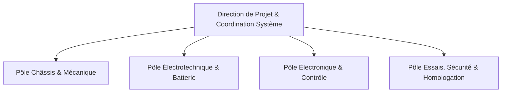

# L'Équipe & Organisation

## Organisation du Projet

Le projet e-Kart s'appuie sur une structure d'ingénierie matricielle répartie en pôles techniques spécialisés. Chaque pôle assure la responsabilité d'un sous-système de sa phase d'étude préliminaire jusqu'à la qualification sur piste.

## Structure des Pôles d'Ingénierie

### Direction de Projet & Intégration Système
- **Missions** : Tenue du cahier des charges, arbitrage des compromis masse/puissance, coordination inter-systèmes, suivi budgétaire et planification des revues de jalon.
- **Livrables** : Matrice des exigences, planning directeur, dossiers de synthèse technique.

### Pôle Châssis & Mécanique
- **Missions** : Dimensionnement géométrique, calculs par éléments finis (FEA), conception CAO 3D des sous-ensembles mécano-soudés, liaisons au sol, cinématique de direction et système de freinage hydraulique.
- **Livrables** : Plans de fabrication 2D (DXF), modèles 3D (STEP), notes de calcul de résistance mécanique.

### Pôle Électrotechnique & Batterie
- **Missions** : Dimensionnement du pack accumulateur (chimie, topologie série/parallèle), sélection du BMS (Battery Management System), étude thermique du pack et intégration du contrôleur de puissance (onduleur / ESC).
- **Livrables** : Schémas d'interconnexion de puissance, bilan thermique, procédure d'assemblage sous tension.

### Pôle Électronique Embarquée & Télémétrie
- **Missions** : Développement du calculateur central (MCU), gestion du bus CAN, tableau de bord numérique, chaîne d'acquisition de données (accéléromètres, sondes de température, courant/tension) et communication sans fil.
- **Livrables** : Schémas électroniques, routage PCB (Gerber), firmware C/C++ et dashboards de télémétrie.

## Matrice des Responsabilités (RACI)

| Sous-système / Tâche | Direction | Mécanique | Électrotechnique | Embarqué | Essais |
|:---|:---:|:---:|:---:|:---:|:---:|
| Définition du cahier des charges | **R** | C | C | C | C |
| Dimensionnement du châssis | A | **R** | I | I | C |
| Conception de la chaîne cinématique | A | **R** | C | I | C |
| Assemblage du pack batterie | A | C | **R** | C | C |
| Câblage faisceau de puissance HV | A | C | **R** | C | C |
| Développement firmware MCU & CAN | A | I | C | **R** | C |
| Campagnes d'essais sur piste | A | C | C | C | **R** |

*Légende : **R** = Réalisateur (Responsible), **A** = Approbateur (Accountable), **C** = Consulté (Consulted), **I** = Informé (Informed).*
