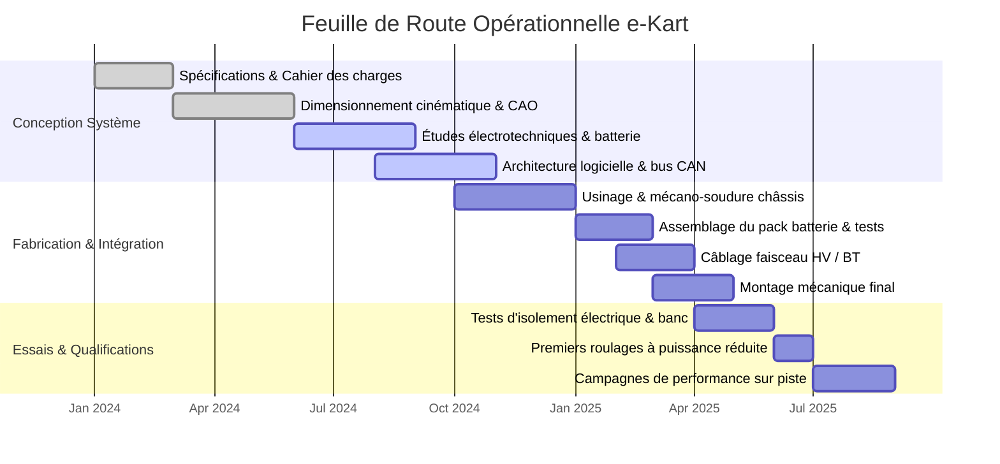

# Planning & Jalons

## Diagramme de Gantt Directeur

Le calendrier du projet s'articule autour de trois grandes phases : conception détaillée, fabrication / intégration atelier, et qualifications sur banc et piste.

## Jalons Techniques Majeurs

Jalon M1 — T1 2024

### :fontawesome-solid-flag-checkered: Revue des Exigences Initiales (SRR)
Validation du cahier des charges fonctionnel, des cibles d'autonomie et de masse globale.

Jalon M2 — T2 2024

### :fontawesome-solid-pencil-ruler: Revue de Conception Préliminaire (PDR)
Finalisation des modèles CAO 3D du cadre châssis et sélection des composants clés (moteur BLDC, ESC, cellules).

Jalon M3 — T4 2024

### :fontawesome-solid-hammer: Revue Critique de Conception (CDR) & Début Usinage
Lancement des approvisionnements matière (tubes 25CrMo4), découpe laser des supports et début de mécano-soudure.

Jalon M4 — T1 2025

### :fontawesome-solid-bolt: Intégration de Puissance & Faisceau
Assemblage sécurisé du pack batterie, mise en service du BMS et validation des verrouillages de sécurité haute tension.

Jalon M5 — T3 2025

### :fontawesome-solid-road: Qualification Dynamique & Mesures
Premières sessions de roulage sur piste fermée avec acquisition télémétrique haute fréquence et validation de la tenue thermique.

